# Latrodectus downloader / backdoor (Latrodectus-family implant) analysis

**TLP:CLEAR** · Report MJN20261106-6091f2 · 2026-11-06 · Malspark Malware Analysis Report  
**Verdict:** Malware (high confidence) · **Severity:** High · **Family:** Latrodectus (moderate-to-high confidence)[[1]](evidence-bundle.html#cite-1) · **Category:** downloader / backdoor (Latrodectus-family implant)  
**Sample:** `6091f2589fef42e0ab3d7975806cd8a0da012b519637c03b73f702f7586b21ef` (pe, 60,928 bytes)

## 1. Executive summary

- The sample reaches two decoded candidate C2 URLs, hxxps://titnovacrion[.]top/live/ and hxxps://skinnyjeanso[.]com/live/, through a WinINet beacon that uses the POST verb, a Content-Type of application/x-www-form-urlencoded and the user-agent Mozilla/4.0 (compatible; MSIE 7.0; Windows NT 5.1; Tob 1.1). The report body carries fields such as counter, guid, os, arch, username, group, ver and up, and the sandbox recorded no HTTP session to either domain.[[2]](evidence-bundle.html#cite-2)
- Code fetches a payload over WinINet (InternetReadFile, with URLDownloadToFileA/W present as resolved APIs) and either writes it with NtCreateFile and NtWriteFile and starts it through CreateProcessW or rundll32.exe, or runs it from a VirtualAlloc buffer on a new thread. No dropped file was recorded in the sandbox run, so this download-and-run path is a code-level capability only.[[3]](evidence-bundle.html#cite-3)
- The sample has a logon-triggered persistence path: the decoded string LogonTrigger and the task name Updater sit beside resolved CoCreateInstance and CoInitializeEx calls, which we assess registers a scheduled task that runs at logon. The registration itself was not observed, because the sandbox report carries no tasks or services section.[[4]](evidence-bundle.html#cite-4)
- Decoded command strings drive host and domain reconnaissance through a cmd.exe routine at 0xae78's call sites: systeminfo, ipconfig /all, whoami /groups, nltest /domain_trusts, net view, net group "Domain Admins" /domain, net config workstation, and a WMI AntiVirusProduct query via wmic.exe. The output is posted in fields such as &systeminfo=, &ipconfig= and &net_wmic_av=, and the commands were not observed to run.[[5]](evidence-bundle.html#cite-5)
- The sample resolves its imports at run time through CRC-32 hashes, so its import table (KERNEL32 and USER32 only) does not describe its capability. The resolved set includes process-injection and memory primitives (OpenProcess, ReadProcessMemory, WriteProcessMemory, CreateRemoteThread, NtWriteVirtualMemory, NtCreateSection, NtMapViewOfSection, QueueUserAPC) and WinINet, URLMON and IPHLPAPI functions.[[6]](evidence-bundle.html#cite-6)
- Its strings are XOR-encoded in .data and decoded at run time by routine 0xae78, using an 8-bit rolling XOR with seed 0x33629d40 and first key 0x41, so the plain-text strings contain no usable indicators. The decoding routine also carries the 'Update_%x', 'Custom_update', 'Updater' and 'runnung' strings used by the persistence and self-update paths.[[7]](evidence-bundle.html#cite-7)
- The sample is a 64-bit, unsigned DLL under an EXE file name, with no recognised packer signature. It is flagged malicious by most engines, and the labels split on family, with Latrodectus named most often and IcedID in several labels, so we assess with high confidence that it is malware and with moderate-to-high confidence that it belongs to the Latrodectus family.[[8]](evidence-bundle.html#cite-8)
- The sample's sandbox run recorded no C2 contact, dropped file or registry activity, and no local YARA rule matched; in the 576-second packet capture none of the 14 external conversations is attributed to it. The only sandbox-observed processes are two rundll32.exe launches of the sample with the #1 export and an unattributed svchost.exe -k GPSvcGroup process.[[9]](evidence-bundle.html#cite-9)

**Assessment:** the verdict is Malware (high confidence); the family is Latrodectus (moderate-to-high confidence)[[1]](evidence-bundle.html#cite-1); the severity is high.

_In the evidence bundle: [Key findings](evidence-bundle.html#sec-key-findings)._

## 2. Introduction and scope

This report covers one file, `6091f2589fef42e0ab3d7975806cd8a0da012b519637c03b73f702f7586b21ef.exe` (pe, 60,928 bytes), submitted for analysis and examined by an automated team of language-model analysts (7 analysts) working over tool servers; a judge stated the verdict and a report model wrote the assessed prose. A sandbox recorded the sample's behaviour. The evidence is partial: 1 of 149 tool calls failed. A step or finding read from the code is marked assessed; one a sandbox watched is marked observed.

### Context

The sample is a 60,928-byte Windows PE file (MIME application/x-msdownload)[[10]](evidence-bundle.html#cite-10). It was submitted under the file name 6091f2589fef42e0ab3d7975806cd8a0da012b519637c03b73f702f7586b21ef.exe[[11]](evidence-bundle.html#cite-11). Its hashes are SHA-256 6091f2589fef42e0ab3d7975806cd8a0da012b519637c03b73f702f7586b21ef, MD5 71d29d71641017e51b3685ce2f417796, SHA-1 e456eb06758c7349a3636c15c91e1a9c30bb7927 and imphash db7aeb75528663639689f852fd366243[[12]](evidence-bundle.html#cite-12). The PE header declares a DLL (machine 34404, 0x8664) with five sections, linker 14.0 and four exports, so the .exe suffix of the submitted name does not describe the file type[[13]](evidence-bundle.html#cite-13). The file carries no Authenticode signature[[14]](evidence-bundle.html#cite-14). The evidence does not record where the file was obtained, which source or channel delivered it, or who submitted it; this report does not state those facts.

The analysis combined a triage pack, static parsing of the PE structure, string and capability scans, emulated decoding of the stored strings, a function-level read of the code, a sandbox run and a packet capture of 1,474 packets over 576.0 s[[15]](evidence-bundle.html#cite-15). In the sandbox the file was launched as a DLL through rundll32 with the export ordinal #1; that launch is the harness's action, and the sandbox recorded three processes in total[[16]](evidence-bundle.html#cite-16). The sandbox report lacks its API-call, registry, file, mutex, service and event sections, and it dropped no files[[17]](evidence-bundle.html#cite-17). The sandbox network section lists two hosts[[18]](evidence-bundle.html#cite-18).

For reputation, VirusTotal flags the file as malicious in 56 of 75 engines[[19]](evidence-bundle.html#cite-19). The local YARA corpus gives 0 hits of 31 rules[[20]](evidence-bundle.html#cite-20). The platform's classification reads downloader / backdoor with family Latrodectus. Engine labels disagree on family and several name IcedID, and the sandbox signature names a Latrodectus loader[[21]](evidence-bundle.html#cite-21). This report treats the family as not established by the label alone.

_In the evidence bundle: [Methodology](evidence-bundle.html#sec-methodology), [Background](evidence-bundle.html#sec-background)._

## 3. Sample metadata

| Field | Value |
|---|---|
| File name | `6091f2589fef42e0ab3d7975806cd8a0da012b519637c03b73f702f7586b21ef.exe` |
| Size | 60,928 bytes |
| Type | pe, x86-64, DLL |
| Name and type | a DLL submitted under an .exe name |
| Compile timestamp | 2024-03-25T15:54:25+00:00 (header value) |
| Export name | `UpdaterTag.dll` |
| Signed | no[[14]](evidence-bundle.html#cite-14) |
| Reputation | VirusTotal: 56 of 75 engines flag it as malicious (analysis 2026-10-27T08:00:46Z; get_file_report, [[22]](evidence-bundle.html#cite-22)) |
| MD5 | `71d29d71641017e51b3685ce2f417796` |
| SHA-1 | `e456eb06758c7349a3636c15c91e1a9c30bb7927` |
| SHA-256 | `6091f2589fef42e0ab3d7975806cd8a0da012b519637c03b73f702f7586b21ef` |
| imphash | `db7aeb75528663639689f852fd366243` |

Sections (5), with entropy: `.text` 5.42, `.rdata` 4.68, `.data` 6.48, `.pdata` 3.87, `.reloc` 0.08.
Imports: 5 functions from 2 libraries: `KERNEL32.dll!PeekNamedPipe`, `KERNEL32.dll!GetLastError`, `KERNEL32.dll!CreateMutexW`, `USER32.dll!MessageBeep`, `USER32.dll!MessageBoxA`.
Exports (4): `extra`, `follower`, `run`, `scub`. All 4 exports share one address, 0x3ce4.

_In the evidence bundle: [Sample overview](evidence-bundle.html#sec-sample-overview), [Static properties](evidence-bundle.html#sec-static-properties)._

## 4. Execution flow

```mermaid
flowchart TD
    s1["1. The sandbox launched the file as a DLL through rundll32.exe with the #35;1… (observed)"]
    s2["2. Entry: the four exports extra, follower, run and scub all resolve to… (assessed)"]
    s3["3. Routine 0x3868 resolves its Windows APIs by CRC32 hash through the… (assessed)"]
    s4["4. 0x3868 creates a named mutex through slot 0x10c60 and fails when… (assessed)"]
    s5["5. On the success path, 0x3868 calls 0x6988, which decodes the two C2 URLs… (assessed)"]
    s6["6. Install branch: 0x3868 uses the result of 0x378c, which tests whether… (assessed)"]
    s7["7. 0x33ac calls 0x3728, then 0xb344, which creates the Task Scheduler… (assessed)"]
    s8["8. After the copy and task steps, 0x33ac calls 0x3a24, which opens the… (assessed)"]
    s9["9. 0x6250 starts the beacon thread 0x5750 with CreateThread. (assessed)"]
    s10["10. On its first cycle the beacon gathers host data through 0x7fa8… (assessed)"]
    s11["11. The beacon formats its report with the template… (assessed)"]
    s12["12. The reply is base64-decoded, RC4-decrypted and parsed by 0x541c for… (assessed)"]
    s13["13. Steady state, assessed: the sandbox recorded no DNS or HTTP session to… (assessed)"]
    s1 --> s2
    s2 --> s3
    s3 --> s4
    s4 --> s5
    s5 --> s6
    s6 --> s7
    s7 --> s8
    s8 --> s9
    s9 --> s10
    s10 --> s11
    s11 --> s12
    s12 --> s13
```



1. The sandbox launched the file as a DLL through rundll32.exe with the #1 export ordinal, in two rundll32 processes; this is the harness launch, not code the sample builds. A third process, svchost.exe -k GPSvcGroup, was observed and is not attributed to the sample.[[23]](evidence-bundle.html#cite-23) _(observed)_
2. Entry: the four exports extra, follower, run and scub all resolve to RVA 0x3ce4. Export extra calls 0x3cb4, which calls the main routine 0x3868.[[24]](evidence-bundle.html#cite-24) _(assessed)_
3. Routine 0x3868 resolves its Windows APIs by CRC32 hash through the tables at 0x84e4, 0x904c, 0x9484, 0xa59c and 0xac50, and runs environment gates before the beacon starts: a PEB BeingDebugged read (0x8690, 0x309c, 0x3074), an OS-version check (0x8560), a process-count check (0x8820) and an adapter check (0x68e8). A failed gate returns -1, and 0x3cb4 then loops on Sleep(1000) without returning.[[25]](evidence-bundle.html#cite-25) _(assessed)_
4. 0x3868 creates a named mutex through slot 0x10c60 and fails when GetLastError returns 0xb7 (ERROR_ALREADY_EXISTS). The mutex name is the decoded string 'runnung', which the code passes to CreateMutexW as argument 3 on the path where every conditional jump falls through[[26]](evidence-bundle.html#cite-26).[[27]](evidence-bundle.html#cite-27) _(assessed)_
5. On the success path, 0x3868 calls 0x6988, which decodes the two C2 URLs hxxps://titnovacrion[.]top/live/ and hxxps://skinnyjeanso[.]com/live/ into a two-entry table, and calls 0xcf14, which reads the RC4-encrypted configuration file named update_data.dat.[[28]](evidence-bundle.html#cite-28) _(assessed)_
6. Install branch: 0x3868 uses the result of 0x378c, which tests whether the install copy exists (NtCreateFile through 0x77b0). When the copy is absent, 0x33ac copies the running image to %APPDATA%\Custom_update\Update_<hex>.<ext>, with the name derived from a volume value through 0x30b0 and 0x3194 and the extension chosen by the image-path check in 0x463c.[[29]](evidence-bundle.html#cite-29) _(assessed)_
7. 0x33ac calls 0x3728, then 0xb344, which creates the Task Scheduler object (CoInitializeEx and CoCreateInstance in 0xc5e8) and calls 0xc42c. 0xc42c adds a logon trigger with Id 'LogonTrigger' (0xc2c4), an exec action (0xc19c), principal and settings (0xc8c4, 0xc7b4), then calls RegisterTaskDefinition through vtable slot +0x88 with flags 6 under the name 'Updater'. Registration is not observed.[[30]](evidence-bundle.html#cite-30) _(assessed)_
8. After the copy and task steps, 0x33ac calls 0x3a24, which opens the running image with DELETE access, renames its default data stream to ':wtfbbq' through SetFileInformationByHandle class 3, and sets delete-on-close (class 4). It then starts the copy through CreateProcessW (0xb400, rundll32.exe in DLL mode) and calls ExitProcess.[[29]](evidence-bundle.html#cite-29) _(assessed)_
9. 0x6250 starts the beacon thread 0x5750 with CreateThread. The beacon waits about 180 s (1800 × 100 ms) and then sleeps 450 to 599 s between cycles, or 1500 to 2099 s when a flag is set.[[31]](evidence-bundle.html#cite-31) _(assessed)_
10. On its first cycle the beacon gathers host data through 0x7fa8 (GetComputerNameExA, GetAdaptersInfo, MAC formatting with %02x), 0x8560 (GetVersionExW and RtlGetVersion), and 0x8ae0 (GetUserNameA). Discovery thread 0x2200, started by 0x2118 through CreateThread on command 4, runs cmd.exe and wmic.exe command lines through the pipe routine 0x1030. The lines are ipconfig /all, systeminfo, whoami /groups, net view, nltest /domain_trusts, net group 'Domain Admins', net config workstation and the AntiVirusProduct WMI query. The process list is built by 0x1c38 with CreateToolhelp32Snapshot, Process32First and Process32Next.[[32]](evidence-bundle.html#cite-32) _(assessed)_
11. The beacon formats its report with the template counter=%d&type=%d&guid=%s&os=%d&arch=%d&username=%s&group=%lu&ver=%d.%d&up=%d&direction=%s, encrypts it with RC4 under the key '12345' (0xcbe0, 0xca08, 0xcaac), base64-encodes it (0x6634) and sends it with POST through WinINet (0x4c70, 0x5030) to the decoded C2 URLs.[[33]](evidence-bundle.html#cite-33) _(assessed)_
12. The reply is base64-decoded, RC4-decrypted and parsed by 0x541c for CLEARURL, URLS and COMMAND tokens. A COMMAND token's numeric id goes to dispatcher 0x3cf4, whose cases cover the discovery, process-list, download-and-run (0xc, 0xd, 0xe, 0x15), self-update (0xf) and exit (0x11) paths. The numeric values on the wire were not observed.[[29]](evidence-bundle.html#cite-29) _(assessed)_
13. Steady state, assessed: the sandbox recorded no DNS or HTTP session to either decoded C2 name, no command reply, no dropped file and no cmd.exe or wmic.exe child process. The run therefore does not show the beacon's timed loop past its first cycle; that loop is assessed to continue from the code, not observed.[[34]](evidence-bundle.html#cite-34) _(assessed)_

_In the evidence bundle: [Execution flow](evidence-bundle.html#sec-execution-flow), [Observed behaviour](evidence-bundle.html#sec-observed-behaviour)._

## 5. Functionality

### 5.1 Packing, obfuscation and anti-analysis

No packer is present in the analysed sample. The PE reader reports an empty packer-signature list, and the packer scan matched no packer signature[[13]](evidence-bundle.html#cite-13). The packer scan's only matched rule is HasRichSignature at 0xb8, a Rich header that is a linker artefact, so its packed flag rests on no packing content[[36]](evidence-bundle.html#cite-36). The PE reader reports no overlay and no resources, and the carver found no embedded, split, bitmap-hidden or encrypted PE[[37]](evidence-bundle.html#cite-37). Section entropy is 5.42 (.text), 6.48 (.data), 4.68 (.rdata), 3.87 (.pdata) and 0.08 (.reloc)[[13]](evidence-bundle.html#cite-13). The highest value lies in .data, where the encoded string blobs sit; we assess that this reflects those blobs rather than a packed body[[38]](evidence-bundle.html#cite-38). No YARA rule of the 31 tested matched[[20]](evidence-bundle.html#cite-20).

The sample does obfuscate its text. Its strings are stored XOR-encoded in .data and decoded at run time by the routine at 0xae78[[38]](evidence-bundle.html#cite-38). The routine reads a 4-byte seed, then a 2-byte length XORed with the low 16 bits of the seed, then the encoded bytes. Byte i is XORed with the low byte of (seed + 1 + i). For the seed 0x33629d40 the first key is 0x41, so byte i uses 0x41 + i[[39]](evidence-bundle.html#cite-39). The blob at 0x10250 shows the layout: header 40 9d 62 33 5f 9d, length 0x9d5f XOR 0x9d40 = 31 bytes (30 characters and a NUL), and a one-step decode yields a URL[[40]](evidence-bundle.html#cite-40). The platform decoder recovered 101 blobs, and FLOSS emulation recovered 81 strings, 90 of the blobs also being recovered by FLOSS[[41]](evidence-bundle.html#cite-41). The decoded text includes command-line fragments, WMI and WinINet strings, registry and file paths, and the network values, which are given under command and control[[42]](evidence-bundle.html#cite-42). The decoder skips encoded text whose bytes already read as printable, so further encoded text may remain undecoded[[38]](evidence-bundle.html#cite-38). The plain-text run list yields 218 runs and the plain-text IOC scan returns no indicators, so the plain strings carry no network or host values[[43]](evidence-bundle.html#cite-43).

API names are hidden as well. The routine at 0x8690 reads the PEB through the GS segment at offset 0x60[[44]](evidence-bundle.html#cite-44), and the resolver at 0x869c parses PE export tables[[45]](evidence-bundle.html#cite-45). The platform's scan recovered 164 Windows function and module names from stored CRC32 values, across 10 hash algorithms[[46]](evidence-bundle.html#cite-46). The CRC-32 routine at 0x6aa4 uses the CRC-32 polynomial constant, and the FNV routine at 0xc99c uses the FNV-32 offset basis and prime[[47]](evidence-bundle.html#cite-47). The hashing structure is established; the individual name-to-hash mappings are recovered by scan and have moderate confidence until confirmed by emulation. Capa also reports obfuscated stack strings at 0x9484 and an RC4 PRGA routine at 0xcaac[[45]](evidence-bundle.html#cite-45). Capa's T1027 and T1027.005 labels are its rule metadata.

The analysed sample carries two evasion-relevant behaviours: obfuscation of its strings and API names, and self-deletion of its own image. The deterministic anti-debug API count is zero, and the Ghidra anti-analysis scan matched only a single PEB read (GS segment, offset 0x60) at 0x8690, which the capa rule also reports as PEB access[[48]](evidence-bundle.html#cite-48). The sample is not packed by any known signature and matched none of the 31 YARA rules run[[49]](evidence-bundle.html#cite-49). The analysed sample is therefore not shown to use anti-debug or environment checks.

Data obfuscation is the main evasion measure. Most strings are stored as XOR-encoded blobs with a rolling 8-bit key (seed 0x33629d40, first key 0x41, UTF-16LE or ASCII text) and are decoded at run time by routine 0xae78, whose body XORs each encoded byte with a key stream advanced per byte[[50]](evidence-bundle.html#cite-50). Emulation recovered 81 decoded strings and the platform decoded 101 blobs[[42]](evidence-bundle.html#cite-42). API names are resolved at run time from CRC-32 hashes: 164 hashed values resolve to Windows functions and modules, and the resolver routines sit at 0x84e4 and 0x904c[[51]](evidence-bundle.html#cite-51). The capa rules report obfuscated stack strings at 0x9484, CRC-32 hashing at 0x6aa4, RC4 PRGA at 0xcaac and FNV hashing at 0xc99c[[52]](evidence-bundle.html#cite-52). Dynamic API resolution (T1027.007) is therefore the sample's main way of hiding its imports, since its import table lists only KERNEL32.dll and USER32.dll[[13]](evidence-bundle.html#cite-13).

Self-deletion is implemented in routine 0x3a24. It gets the module path through the GetModuleFileNameW wrapper 0x841c, called from 0x463c[[53]](evidence-bundle.html#cite-53). It opens that path with DELETE access, sets a FILE_RENAME_INFO whose target is the decoded text :wtfbbq (the string at 0xfa18) through SetFileInformationByHandle class 3, closes the handle, reopens the file and sets FileDispositionInfo (class 4) with delete-on-close[[54]](evidence-bundle.html#cite-54). A rename whose target has no base name moves the default data stream into a named alternate data stream on NTFS, so the code removes the running image's directory entry while its content remains in the stream. Routine 0x33ac, the install path, calls 0x3a24 after its copy step and before launching a new process through the CreateProcessW wrapper 0xb400[[55]](evidence-bundle.html#cite-55). Dispatch case 0xf in 0x3cf4 calls 0x3c2c, 0x3a24 and 0x3808, then starts a fresh copy[[56]](evidence-bundle.html#cite-56). Routine 0x3808 builds the install path through 0x30d0 and 0x3250 and deletes it through the NtDeleteFile wrapper 0x7694[[57]](evidence-bundle.html#cite-57). The install-path strings are Custom_update, Update_%x, .dll, .exe and AppData[[27]](evidence-bundle.html#cite-27).

No file activity was observed in the run. The sandbox reported zero dropped files and no files section, and its observed process was rundll32 running the sample as a DLL with the #1 export[[58]](evidence-bundle.html#cite-58). The rename, the delete and the copy step are therefore established only from code. We assess with high confidence that 0x3a24 renames and then schedules deletion of the running image, and with moderate confidence that it runs in the install and self-update paths. The copy step is inferred: the code shown calls file-creation wrappers from 0x33ac, but the copy destination is not established.

Encryption scheme[[35]](evidence-bundle.html#cite-35):

| Property | Value |
|---|---|
| Cipher | RC4 (stream cipher, key schedule and PRGA), used for C2 beacon traffic; no file-encryption use is shown in the analysed sample [ev_0008, ev_0021] |
| Library | None: RC4 is implemented in the sample's own code, and the file imports only KERNEL32.dll and USER32.dll with no crypto API [ev_0004, ev_0023] |
| Key source | Hard-coded text key "12345", decoded from the blob at 0xfd30 by routine 0xae78 and referenced from the beacon routine 0x5750 at 0x57d0 [ev_0021] |
| Key management | Static shared key compiled into the sample; no key generation, wrapping or exchange is shown [ev_0021] |
| Per-file key | no |


### 5.2 API and string resolution

The sample resolves most of its Windows API surface at run time rather than through its import table. The static import table holds five names from two libraries (KERNEL32: PeekNamedPipe, GetLastError, CreateMutexW; USER32: MessageBeep, MessageBoxA)[[13]](evidence-bundle.html#cite-13). The resolver finds 164 Windows function and module names from stored 32-bit CRC values, across 27 DLLs and 108 module names, using CRC-32 variants: crc32_ascii for API names and crc32_utf16le (with a lower-case variant) for module names[[46]](evidence-bundle.html#cite-46). The hash values sit in tables at 0x84e4 (kernel32 module names), 0x904c (WinINet, urlmon, shell32, advapi32, shlwapi, iphlpapi, user32), 0x9484 (kernel32 process, thread, memory, file and pipe APIs, plus ntdll critical-section calls), 0xa47c (module names), 0xa59c (ntdll Nt* and Rtl APIs and LdrLoadDll) and 0xac50 (ole32)[[46]](evidence-bundle.html#cite-46). The resolution routine at 0x869c walks the export table of a loaded module and calls the CRC-32 routine 0x6aa4 on each export name, returning the first match[[59]](evidence-bundle.html#cite-59). The PEB is read at 0x8690 through the GS segment at offset 0x60[[48]](evidence-bundle.html#cite-48). Four functions call 0x869c[[60]](evidence-bundle.html#cite-60).

The structure is confirmed; the individual values are not. Emulating 0x6aa4 against the CreateMutexW value 0x2d789102 returned no match over five candidates[[61]](evidence-bundle.html#cite-61). The CRC-32 polynomial constant in the file agrees with 0x6aa4[[62]](evidence-bundle.html#cite-62). The hash-to-name rows are therefore the platform's reading, and each name should be treated as unverified until the hash is reproduced. Two entries are listed under both kernel32.dll and kernelbase.dll, which reflects that the same export is reachable through either module[[46]](evidence-bundle.html#cite-46).

The resolved names are wired to call sites through slots. Examples from the per-function index: 0x1c38 and 0x14d8 call CreateToolhelp32Snapshot, Process32First and Process32Next; 0x7fa8 calls GetAdaptersInfo and GetComputerNameExA; 0x8d90 calls InternetOpenW, InternetOpenUrlW and InternetReadFile; 0x8560 calls GetVersionExW and RtlGetVersion; 0x463c calls OpenProcess, ReadProcessMemory and NtQueryInformationProcess; 0x1030 calls CreatePipe, CreateProcessW, PeekNamedPipe and ReadFile[[60]](evidence-bundle.html#cite-60). Several ntdll calls are made through slots without a Win32 wrapper, including NtAllocateVirtualMemory (wrapper 0xad34, 31 callers) and NtFreeVirtualMemory (0x7b40, 41 callers)[[60]](evidence-bundle.html#cite-60).

The resolved set spans more behaviour than the imports. By resolved name, the profile is filesystem 22, process_injection 18, execution 15, network 11, discovery 10, anti_debug 7, registry 5, evasion 4 and persistence 4; the import-only read gives persistence 1[[63]](evidence-bundle.html#cite-63). These are catalogue associations, not observations. The resolved set includes VirtualAllocEx, WriteProcessMemory and CreateRemoteThread, but in the analysed sample's function index no routine calls WriteProcessMemory or CreateRemoteThread through a slot, and the only process-access calls are the OpenProcess, ReadProcessMemory and NtQueryInformationProcess calls in 0x463c[[51]](evidence-bundle.html#cite-51).

Strings are stored XOR-encoded in .data and decoded at run time by routine 0xae78. The routine reads a 4-byte seed and a 2-byte length word XORed with the seed's low 16 bits, then XORs each text byte with the low byte of a running value that starts at seed+1 and increases by one per byte. The routine 0x9040 returns its argument plus one, which provides that running value[[64]](evidence-bundle.html#cite-64). With seed 0x33629d40 the first key is 0x41[[38]](evidence-bundle.html#cite-38). The decoder yields 101 blobs from .data, 90 of which match texts recovered by FLOSS emulation of the same routine[[41]](evidence-bundle.html#cite-41). Static decoding of blob 0xfac0 gives the UTF-16LE text init -zzzz= followed by two %s fields in quotes, 38 bytes long[[65]](evidence-bundle.html#cite-65). FLOSS's rendering of the same call site at 0x4571 omits the zzzz run[[27]](evidence-bundle.html#cite-27). The static decode is taken as the text the routine formats. Plain-text scanning finds no indicators in the 218 ASCII and UTF-16 runs, so the API names, command strings and URLs are reachable only through this decoding or through the hash tables[[43]](evidence-bundle.html#cite-43).


### 5.3 Persistence

The analysed sample's persistence is a logon-triggered Task Scheduler task named 'Updater', created by the install routine at 0x33ac. Its code is reached from the gate at 0x3868[[53]](evidence-bundle.html#cite-53). The gate calls 0x378c, which opens a path built by 0x3250 through the NT file-open routine at 0x77b0 and returns whether the open succeeded[[66]](evidence-bundle.html#cite-66). Routine 0x3868 calls 0x33ac only when 0x378c returns zero, so we assess the install branch runs when that open fails. Before that point, 0x3868 applies version and process-count checks through 0x8560 and 0x8820 and exits with -1 when they fail[[67]](evidence-bundle.html#cite-67). The export 'extra' (0x3ce4) calls 0x3cb4, which calls 0x3868[[68]](evidence-bundle.html#cite-68). The export table lists four names: extra, follower, run and scub[[69]](evidence-bundle.html#cite-69).

Routine 0x33ac first copies the module path, held in DAT_1360bc10448 and set through GetModuleFileNameW in 0x841c[[70]](evidence-bundle.html#cite-70), to a new file. The destination is built by 0x3250 from the AppData folder (0x7b98 index 0) plus a name from 0x3194 in the 'Update_%x' format and a '.dll' or '.exe' suffix[[71]](evidence-bundle.html#cite-71). The copy routine 0x7504 is called with its delete flag clear, so the source is not removed[[72]](evidence-bundle.html#cite-72). The task name 'Updater' is the decoded string at 0xf988[[73]](evidence-bundle.html#cite-73). The action program and arguments depend on flag DAT_1360bc10488. When the flag is nonzero, the program is 'rundll32.exe' (0xf9b8) and the arguments are formatted from the copy path (0xf9d8). When it is zero, the program is formatted from 0xf9a0 with the copy path, and the arguments are the literal at 0xf9b0[[74]](evidence-bundle.html#cite-74). The texts at 0xf9a0, 0xf9b0 and 0xf9d8 are not decoded in the analysed sample's string recovery, so their values are not stated here.

Routine 0x33ac passes name, program and arguments to 0x3728, which passes them to 0xb344 with the user name from GetUserNameA (0x8ae0)[[75]](evidence-bundle.html#cite-75). Routine 0xb344 calls CoInitializeEx and CoCreateInstance through 0xc5e8[[76]](evidence-bundle.html#cite-76) and then 0xc42c[[77]](evidence-bundle.html#cite-77). Routine 0xc42c calls 0xc2c4, which gets the trigger collection and creates a logon trigger (type 9) with the Id 'LogonTrigger' (0x10030)[[78]](evidence-bundle.html#cite-78). It then calls 0xc19c, which sets the exec action's path and arguments[[77]](evidence-bundle.html#cite-77). It calls 0xc7b4, which writes the string 'PT0S' (0x10118) into the task settings[[79]](evidence-bundle.html#cite-79). It calls 0xc8c4 for the principal[[77]](evidence-bundle.html#cite-77). Finally it calls the folder object's vtable slot +0x88 with the path, the definition, flags 6 (create or update), null user and password, and logon type 0[[56]](evidence-bundle.html#cite-56). We assess slot +0x88 is RegisterTaskDefinition, an inference from the argument pattern and not checked against a type library.

After the task call, 0x33ac starts the command it built through CreateProcessW in 0xb400, with CREATE_NO_WINDOW[[72]](evidence-bundle.html#cite-72). This is an immediate launch and not a persistence step.

No Run-key or Startup-folder write appears in the analysed code. Routine 0x7b98 resolves five folder names through the Shell Folders key using 0xb154, which reads the key through 0x88f8 (RtlFormatCurrentUserKeyPath) and 0xb1d4 (NtQueryValueKey, NtClose)[[80]](evidence-bundle.html#cite-80). NtSetValueKey is among the resolved ntdll names[[46]](evidence-bundle.html#cite-46), but no routine calling it appears in the function listings of the analysed sample.

The sandbox observed a rundll32.exe command line naming the sample's .dll with ',#1'[[81]](evidence-bundle.html#cite-81). The sandbox output carries no services, tasks or registry telemetry, so the task registration itself was not observed[[82]](evidence-bundle.html#cite-82).


### 5.4 Discovery

Discovery is carried out by code that runs only after the dispatcher receives a numeric command, and the sandbox run did not exercise it. The static import table holds five entries (PeekNamedPipe, GetLastError, CreateMutexW, MessageBeep, MessageBoxA) and none is a discovery API[[13]](evidence-bundle.html#cite-13). The discovery calls are resolved at run time by CRC32 hash, for example CreateToolhelp32Snapshot at 0x94ef, GetAdaptersInfo at 0x93eb, GetUserNameA at 0x92a3, GetCursorPos at 0x92cc and RtlGetVersion inside the 0xa59c table[[46]](evidence-bundle.html#cite-46).

Host command discovery (T1059.003, T1016, T1082, T1033, T1018, T1482, T1069.002, T1518.001). Dispatcher case 4 calls 0x2118, which creates a thread on 0x2200[[56]](evidence-bundle.html#cite-56). The thread decodes eleven cmd.exe or wmic.exe command pairs with the string decoder 0xae78[[64]](evidence-bundle.html#cite-64). The decoded texts are: 'ipconfig /all', 'systeminfo', 'nltest /domain_trusts', 'nltest /domain_trusts /all_trusts', 'net view /all /domain', 'net view /all', 'net group "Domain Admins" /domain', a WMIC query for AntiVirusProduct (Get * /Format:List, run with C:\Windows\System32\wbem\wmic.exe), 'net config workstation', a WMIC DisplayName query with a 'No Antivirus installed' fallback, and 'whoami /groups'[[42]](evidence-bundle.html#cite-42). Each pair is passed to 0x1030[[83]](evidence-bundle.html#cite-83). The routine 0x1030 creates a pipe, starts the process through the slot that the hash resolution fills with CreateProcessW, sets STARTUPINFO flags |= 0x101 with a hidden window, and reads the output back through PeekNamedPipe and ReadFile[[84]](evidence-bundle.html#cite-84). The eleven outputs are stored in beacon fields by 0xb984: &ipconfig=, &systeminfo=, &domain_trusts=, &domain_trusts_all=, &net_view_all_domain=, &net_view_all=, &net_group=, &wmic=, &net_config_ws=, &net_wmic_av= and &whoami_group=[[85]](evidence-bundle.html#cite-85). The combined buffer is cached in DAT_10548 and handed to the beacon as data type 3[[83]](evidence-bundle.html#cite-83). The code routes these commands to execution: the pipe routine starts cmd.exe with CreateProcessW[[84]](evidence-bundle.html#cite-84), but the sandbox recorded only rundll32.exe and svchost.exe processes and no cmd.exe or net child[[23]](evidence-bundle.html#cite-23), so execution of the commands was not observed.

Process enumeration (T1057). Dispatcher case 3 calls 0x1c38[[56]](evidence-bundle.html#cite-56). That routine takes a Toolhelp snapshot through a slot, walks it with Process32FirstW and Process32NextW, and opens the &proclist=[ field[[77]](evidence-bundle.html#cite-77). For each process it calls 0x14d8, which takes a second snapshot, collects child entries under the "subproc" key and recurses on each child PID[[86]](evidence-bundle.html#cite-86). The count routine 0x8820 walks the same snapshot APIs and returns the number of processes[[87]](evidence-bundle.html#cite-87).

Registry reads (T1012). Routine 0x7b98 passes the Shell Folders key path (0x10330) and five folder names (AppData, Desktop, Startup, Personal, Local AppData at 0x102a0 to 0x10300) to 0xb154[[78]](evidence-bundle.html#cite-78). Routine 0xb154 opens the key through 0x88f8, which uses RtlFormatCurrentUserKeyPath, and reads the value through NtQueryValueKey[[88]](evidence-bundle.html#cite-88). The NtOpenKey slot is in 0xb0c4[[60]](evidence-bundle.html#cite-60). The routine 0x88f8 selects the HKLM root when its first argument is 1 and otherwise builds the current-user path[[89]](evidence-bundle.html#cite-89). The HKLM root text is the decoded literal \Registry\Machine\ at 0x10220[[41]](evidence-bundle.html#cite-41).

Host and identity reads. Routine 0x7fa8 resolves GetComputerNameExA and GetAdaptersInfo, and formats &computername=%s, &mac= and two-digit hex MAC bytes[[90]](evidence-bundle.html#cite-90). Routine 0x8560 maps the OS version reported by RtlGetVersion or GetVersionExW to a value from 0 to 7[[87]](evidence-bundle.html#cite-87). Routine 0x8ae0 resolves GetUserNameA[[60]](evidence-bundle.html#cite-60). Routine 0x88a4 resolves GetCursorPos and GetTickCount[[60]](evidence-bundle.html#cite-60), and routine 0x89d4 resolves FindFirstVolumeW and GetVolumeInformationW[[60]](evidence-bundle.html#cite-60).

Desktop listing. Dispatcher case 2 calls 0x1a08[[56]](evidence-bundle.html#cite-56). That routine calls the SHGetFolderPathA wrapper 0x7f1c with CSIDL 0x10, enumerates the folder with FindFirstFileA and FindNextFileA, skips the '.' and '..' entries, and writes the names under &desklinks=[[[91]](evidence-bundle.html#cite-91).

The C2 reply handler 0x541c parses the numeric command that reaches the dispatcher[[87]](evidence-bundle.html#cite-87). No reply that carries a discovery command was observed in the sandbox run; the reply parser passes a COMMAND id to the dispatcher[[87]](evidence-bundle.html#cite-87), and the numeric ids on the wire were not observed, so the trigger for this routine is not established[[56]](evidence-bundle.html#cite-56).


### 5.5 Payloads and dropped files

No payload is carved from the file. The carver returned zero payloads, the PE has no overlay and no embedded or split PE, and the parsed resource table is empty[[13]](evidence-bundle.html#cite-13). The sandbox recorded 0 dropped files and no files section[[92]](evidence-bundle.html#cite-92), so no second-stage file was observed at run time.

The encoded material in .data is the sample's own text, not a payload. Its decoded blobs (101 texts, 90 also recovered by FLOSS) include the file-name formats the code builds: "%s%d.dll" (0xffe0), "%s%d.exe" (0x10018), "%s\%d.dll" (0xfa70), "%d.dat" (0xfa90), "Update_%x" (0xf920), "Custom_update" (0xf940), "\update_data.dat" (0x103b8) and "files/bp.dat" (0xfa58)[[93]](evidence-bundle.html#cite-93). The blob at 0x10250 decodes to the URL hxxps://titnovacrion[.]top/live/[[38]](evidence-bundle.html#cite-38). These formats name files the code would write; no file body is stored in the image.

The code paths that would create files are as follows, read from the decompiled routines and not observed in a run:

- Download routine 0x6f48 fetches a body through 0x8d90 (WinINet). With a path argument it rejects bodies that begin with "<html>" or "<!DOCTYPE" and writes the body through 0x7acc, which opens the file with NtCreateFile (wrapper 0x77b0, disposition 3) and writes it with NtWriteFile (0x7a54). With no path it returns before any write[[94]](evidence-bundle.html#cite-94). Whether the write branch is reached depends on the return sense of 0xbcac, which is not established.
- Routine 0x6e04 builds a "%s%d.exe" name[[38]](evidence-bundle.html#cite-38), calls 0x6f48[[53]](evidence-bundle.html#cite-53), and when its launch flag is set starts the file with CreateProcessW through 0xb400[[95]](evidence-bundle.html#cite-95).
- Routine 0x6c2c builds a "%s%d.dll" name, calls 0x6f48, and when its flag is set launches the file through 0xb4cc. That routine formats the command line "C:\\WINDOWS\\SYSTEM32\\rundll32.exe %s,%s" and calls CreateProcessW[[78]](evidence-bundle.html#cite-78).
- Routine 0x4110 (the "files/bp.dat" stage) calls 0x6f48 and then 0xb4cc with the argument string "init -zzzz=\"%s\%s\"" (0xfac0)[[96]](evidence-bundle.html#cite-96).
- Routines 0x7170 and 0x72c8 fetch a body with no path, copy it into a VirtualAlloc buffer with protection 0x40, and run it on a new thread (0xb398 and 0xb670). No file is written on that path[[97]](evidence-bundle.html#cite-97).
- Routine 0x33ac copies the running image into %APPDATA%\Custom_update\Update_<hex>.<ext> through 0x7504 and 0x7acc, then starts the copy with CreateProcessW[[98]](evidence-bundle.html#cite-98). Routine 0x3808 deletes the installed copy[[99]](evidence-bundle.html#cite-99).

In the sandbox, two processes carried the command line rundll32.exe with the sample's own path and the export ordinal #1, and a third was svchost.exe -k GPSvcGroup[[16]](evidence-bundle.html#cite-16). We assess the rundll32 launch is the sandbox harness's invocation, since the sample's code builds its rundll32 command from the 0xfe90 format and the name formats above, not from a path it names itself[[81]](evidence-bundle.html#cite-81). The capture's only file GETs are Windows update CAB files and certificate revocation fetches[[100]](evidence-bundle.html#cite-100); no GET for a sample-named file appears.

Confidence that the sample writes and runs downloaded files, as shown in code: high. Confidence that any file was written or run during the sandbox run: none; the run recorded no such file.


_In the evidence bundle: [Technical analysis](evidence-bundle.html#sec-technical-analysis)._

## 6. Command and control

### 6.1 Protocol and endpoints

The sample's C2 is HTTP(S), built around two candidate endpoints. Its decoded strings are hxxps://titnovacrion[.]top/live/ and hxxps://skinnyjeanso[.]com/live/[[106]](evidence-bundle.html#cite-106). Routine 0x6988 decodes both into a two-entry table at DAT_1360bc10568, and the table is filled from the install routine 0x3868[[83]](evidence-bundle.html#cite-83). The beacon thread 0x5750 is started by CreateThread from 0x6250 at the end of 0x3868, and only when the gate in 0x3868 succeeds[[53]](evidence-bundle.html#cite-53). The beacon cycles through the table, cracking each entry with InternetCrackUrlA (0x52c4) and moving to the next entry on failure[[107]](evidence-bundle.html#cite-107).

Transport is WinINet, with every API resolved by hash[[46]](evidence-bundle.html#cite-46). Routine 0x4c70 calls InternetOpenW and InternetConnectA with service type 3 (HTTP)[[108]](evidence-bundle.html#cite-108). Routine 0x5030 calls HttpOpenRequestA, HttpSendRequestA and InternetSetOptionA[[70]](evidence-bundle.html#cite-70). It selects the verb 'POST' (0xfba0) when its second argument is nonzero and 'GET' (0xfbb0) otherwise, and it sends the Content-Type header 'application/x-www-form-urlencoded' (0xfb68)[[109]](evidence-bundle.html#cite-109). The user agent is 'Mozilla/4.0 (compatible; MSIE 7.0; Windows NT 5.1; Tob 1.1)' (0xfbe0 and 0xfc60), used by 0x4d20[[110]](evidence-bundle.html#cite-110). For an HTTPS URL, 0x5030 sets option 0x1f to 0x4380[[53]](evidence-bundle.html#cite-53). The reply is read with InternetReadFile in 255-byte reads by 0x4f58[[99]](evidence-bundle.html#cite-99).

Each report is built by 0x5750 from the template 'counter=%d&type=%d&guid=%s&os=%d&arch=%d&username=%s&group=%lu&ver=%d.%d&up=%d&direction=%s'[[111]](evidence-bundle.html#cite-111). The guid argument is supplied by routine 0x7b80, whose body calls the volume routine 0x89d4 and the routine 0x8bbc[[99]](evidence-bundle.html#cite-99). The group value is the FNV hash of the decoded text 'Littlehw'[[112]](evidence-bundle.html#cite-112); routine 0x463c calls the FNV routine 0xc99c on that text[[53]](evidence-bundle.html#cite-53). Host fields are appended as '&computername=%s', '&domain=%s', '&mac=%02x' and '&ipconfig='[[93]](evidence-bundle.html#cite-93). Discovery output is appended as '&systeminfo=', '&proclist=[' and '&desklinks=['[[93]](evidence-bundle.html#cite-93). The process-list JSON uses '\"pid\": ' and '\"proc\": ' keys[[113]](evidence-bundle.html#cite-113). The report body is RC4-encrypted with the key text '12345' (0xfd30) through 0xcbe0 and 0xcaac, then base64-encoded by 0x6634 before the POST[[114]](evidence-bundle.html#cite-114). The reply is base64-decoded (0x6370), RC4-decrypted with the same key and passed to the parser 0x541c[[115]](evidence-bundle.html#cite-115).

The parser 0x541c splits the decrypted reply into tokens and compares them against the decoded keywords 'CLEARURL', 'URLS' and 'COMMAND'[[116]](evidence-bundle.html#cite-116). The dispatcher's switch covers ids 2, 3, 4, 0xc, 0xd, 0xe, 0xf, 0x11, 0x12, 0x13, 0x14 and 0x15, mapping to the listing, process list, discovery thread, download-and-run and update routines[[56]](evidence-bundle.html#cite-56). The numeric ids as sent on the wire were not observed. After a parse, 0xd1c8 writes the URL table lines 'URLS|%d|%s' encrypted with the DAT_10458 key to the configuration file 'update_data.dat'[[117]](evidence-bundle.html#cite-117).

Beacon timing, from the 0x5750 listing: 1800 iterations of 100 ms (about 180 s) before the first cycle, then a sleep of (rand % 150 + 450) seconds, or (rand % 600 + 1500) seconds when flag DAT_1058c is set[[83]](evidence-bundle.html#cite-83).

Observed behaviour: none of this was observed on the wire. The sandbox network section lists two hosts, one a DNS resolver and one a TCP peer, with no HTTP entries and no DNS lookups for the C2 names[[118]](evidence-bundle.html#cite-118). The sandbox does not attribute these flows to a process of the sample[[18]](evidence-bundle.html#cite-18). The capture holds 1,474 packets and 14 external conversations, none attributed to the sample, and no DNS answer or TLS SNI for either candidate host[[119]](evidence-bundle.html#cite-119). Its HTTP GETs go to Windows update, OCSP and certificate-revocation hosts, with no POST[[120]](evidence-bundle.html#cite-120). The TCP peer carries a domain tag for a certificate-revocation host and is not tied to a C2 role[[121]](evidence-bundle.html#cite-121). The gate 0x3868 can stop the run before any beacon is sent[[53]](evidence-bundle.html#cite-53). We assess, with moderate confidence, that the two decoded URLs are the sample's configured C2 endpoints, and that the sandbox run did not establish contact with them.

| Channel | Protocol | Endpoint(s) | Encryption | Message format |
|---|---|---|---|---|
| HTTP beacon and command channel (beacon thread 0x5750, HTTP helpers 0x4c70, 0x5030, 0x4d20, reply parser 0x541c)[[101]](evidence-bundle.html#cite-101) | HTTP(S) over WinINet (InternetOpenW, InternetConnectA, HttpOpenRequestA, HttpSendRequestA, InternetReadFile, resolved by hash)[[51]](evidence-bundle.html#cite-51) | `hxxps://titnovacrion[.]top/live/`; `hxxps://skinnyjeanso[.]com/live/` | RC4 with the shared text key "12345" (decoded at 0xfd30) over each report, with base64 encoding before the POST and base64 decoding plus RC4 on the reply. The HTTPS scheme is set through InternetSetOptionA security flags 0x4380 when the URL is https. This is code-level; no session was observed[[102]](evidence-bundle.html#cite-102) | counter=%d&type=%d&guid=%s&os=%d&arch=%d&username=%s&group=%lu&ver=%d.%d&up=%d&direction=%s (wsprintfA template, decoded at 0xfd40, used in 0x5750)[[103]](evidence-bundle.html#cite-103). Beacon timing: about 180 s start-up delay, then sleeps of 450 to 599 s, or 1500 to 2099 s when the long-sleep flag is set[[83]](evidence-bundle.html#cite-83). / Form-urlencoded report sent with the verb POST ("POST" at 0xfba0, GET at 0xfbb0) and the header "Content-Type: application/x-www-form-urlencoded"; the user agent is "Mozilla/4.0 (compatible; MSIE 7.0; Windows NT 5.1; Tob 1.1)". Report fields include &computername=%s, &domain=%s, &mac=, &ipconfig=, &systeminfo=, &proclist=[ with "pid" and "proc" keys, &desklinks=[, &domain_trusts=, &net_view_all=, &whoami_group= and similar, and the cached discovery buffers are sent with type tags 3, 4 and 5[[103]](evidence-bundle.html#cite-103). The reply is parsed for the tokens CLEARURL, URLS and COMMAND; COMMAND carries a numeric id passed to dispatcher 0x3cf4[[104]](evidence-bundle.html#cite-104) |
| HTTP file fetch (download path, routines 0x8d90 and 0x6f48)[[105]](evidence-bundle.html#cite-105) | HTTP(S) over WinINet (InternetOpenW, InternetOpenUrlW, InternetReadFile in 0x8d90)[[60]](evidence-bundle.html#cite-60) | - | - | Plain GET of a URL passed as a command argument; the body is checked for a leading "<html>" or "<!DOCTYPE"[[50]](evidence-bundle.html#cite-50) |


### 6.2 Configuration

| Key | Value | How obtained |
|---|---|---|
| C2 URL 1 | hxxps://titnovacrion[.]top/live/[[122]](evidence-bundle.html#cite-122) | decrypted |
| C2 URL 2 | hxxps://skinnyjeanso[.]com/live/[[123]](evidence-bundle.html#cite-123) | decrypted |
| Beacon HTTP verb | POST[[124]](evidence-bundle.html#cite-124) | decrypted |
| Beacon Content-Type header | Content-Type: application/x-www-form-urlencoded[[125]](evidence-bundle.html#cite-125) | decrypted |
| User-Agent string | Mozilla/4.0 (compatible; MSIE 7.0; Windows NT 5.1; Tob 1.1)[[126]](evidence-bundle.html#cite-126) | decrypted |
| Group identifier field | Littlehw[[125]](evidence-bundle.html#cite-125) | decrypted |
| Beacon report template | counter=%d&type=%d&guid=%s&os=%d&arch=%d&username=%s&group=%lu&ver=%d.%d&up=%d&direction=%s[[123]](evidence-bundle.html#cite-123) | decrypted |
| Beacon traffic RC4 key | 12345[[127]](evidence-bundle.html#cite-127) | decrypted |
| String decoder seed and first key | seed 0x33629d40, first_key 0x41[[38]](evidence-bundle.html#cite-38) | static-string |
| Local configuration file name | \update_data.dat[[128]](evidence-bundle.html#cite-128) | decrypted |
| URL table record format | URLS\|%d\|%s\r\n[[129]](evidence-bundle.html#cite-129) | decrypted |
| Scheduled task name | Updater[[130]](evidence-bundle.html#cite-130) | decrypted |
| Scheduled task logon trigger Id | LogonTrigger[[125]](evidence-bundle.html#cite-125) | decrypted |
| Install file name prefix | Update_%x[[41]](evidence-bundle.html#cite-41) | decrypted |
| Install folder | per-user AppData-based folder (shell-folder index 0)[[131]](evidence-bundle.html#cite-131) | inferred |
| Downloaded file name format (DLL) | %s%d.dll[[41]](evidence-bundle.html#cite-41) | decrypted |
| Downloaded file name format (EXE) | %s%d.exe[[41]](evidence-bundle.html#cite-41) | decrypted |
| DLL launch command format | C:\WINDOWS\SYSTEM32\rundll32.exe %s,%s[[125]](evidence-bundle.html#cite-125) | decrypted |
| Staged payload path | files/bp.dat[[132]](evidence-bundle.html#cite-132) | decrypted |
| Download path segment | /files/[[132]](evidence-bundle.html#cite-132) | decrypted |
| Initial delay before first beacon | about 180 s (1800 iterations of a 100 ms sleep)[[83]](evidence-bundle.html#cite-83) | inferred |
| Beacon sleep interval | 450 to 599 s per cycle; 1500 to 2099 s when the long-sleep flag is set[[83]](evidence-bundle.html#cite-83) | inferred |
| Discovery command (host configuration) | /c ipconfig /all[[42]](evidence-bundle.html#cite-42) | decrypted |
| Discovery command (system information) | /c systeminfo[[42]](evidence-bundle.html#cite-42) | decrypted |
| Discovery command (user groups) | /c whoami /groups[[42]](evidence-bundle.html#cite-42) | decrypted |
| Discovery command (domain hosts) | /c net view /all /domain[[42]](evidence-bundle.html#cite-42) | decrypted |
| Discovery command (network hosts) | /c net view /all[[42]](evidence-bundle.html#cite-42) | decrypted |
| Discovery command (domain trusts) | /c nltest /domain_trusts[[42]](evidence-bundle.html#cite-42) | decrypted |
| Discovery command (all domain trusts) | /c nltest /domain_trusts /all_trusts[[42]](evidence-bundle.html#cite-42) | decrypted |
| Discovery command (domain admins) | /c net group "Domain Admins" /domain[[42]](evidence-bundle.html#cite-42) | decrypted |
| Discovery command (workstation configuration) | /c net config workstation[[42]](evidence-bundle.html#cite-42) | decrypted |
| Init format string | init -zzzz=\"%s\%s\"[[133]](evidence-bundle.html#cite-133) | decrypted |

### 6.3 Commands

| ID | Command | Description |
|---|---|---|
| 0x2 | desktop listing | The dispatcher calls 0x1a08 with no argument. That routine resolves SHGetFolderPathA through the wrapper 0x7f1c with CSIDL 0x10 (desktop), enumerates the folder with FindFirstFileA and FindNextFileA, and builds a JSON list under the field '&desklinks=['. Its result is stored in DAT_1360bc10560 for the beacon. The dispatcher compares ids in hex; the reply parser reads the wire number in decimal, so 0x2 is wire value 2, and 0x12 and 0x15 are wire values 18 and 21[[134]](evidence-bundle.html#cite-134).[[38]](evidence-bundle.html#cite-38) |
| 0x3 | process list | The dispatcher calls 0x1c38, which takes a Toolhelp snapshot (CreateToolhelp32Snapshot), walks it with Process32First and Process32Next, and writes a JSON list under '&proclist=[' and '\"proc\": '. Its result is stored in DAT_1360bc10558 for the beacon[[135]](evidence-bundle.html#cite-135). |
| 0x4 | host and domain discovery | The dispatcher calls 0x2118, which starts thread 0x2200 with CreateThread. Thread 0x2200 passes each decoded discovery command line with the cmd.exe path to 0x1030. That routine creates a pipe, starts cmd.exe with CreateProcessW, and reads the output with PeekNamedPipe and ReadFile. The commands are ipconfig /all, systeminfo, whoami /groups, net view /all /domain, net view /all, nltest /domain_trusts, nltest /domain_trusts /all_trusts, net group 'Domain Admins' /domain, net config workstation, and a WMIC AntiVirusProduct query through wmic.exe. Each output is appended to its own beacon field (for example &ipconfig=, &systeminfo=, &domain_trusts=, &net_group=), and the combined buffer is cached in DAT_1360bc10548[[136]](evidence-bundle.html#cite-136). The dispatcher first applies the 'front' prefix rewrite to this id's argument (see 0xc). |
| 0xc | download EXE and run | The dispatcher rewrites the argument first. If it is longer than 8 characters and begins with the decoded 'front' prefix (case-insensitive), it is copied up to its first single slash, the decoded '/files/' is appended, and the rest of the argument follows[[96]](evidence-bundle.html#cite-96). It then calls 0x6e04 with the argument as the URL and launch flag 1. That routine formats '%s%d.exe' with the folder from 0x7e90 (CSIDL 0x1c, Local AppData), fetches the URL over WinINet through 0x6f48, and writes the body to that file through 0x7acc (NtCreateFile and NtWriteFile). It starts the file with CreateProcessW through 0xb400 when the body is non-empty. The write is gated by a prefix compare against '<html>' and '<!DOCTYPE' (0xbcac), whose outcome is not fully resolved[[137]](evidence-bundle.html#cite-137). |
| 0xd | download DLL and run through rundll32 | The dispatcher calls 0x6c2c with the argument and launch flag 1. The argument is split by 0xbfcc into a URL and an export name. The routine formats '%s%d.dll' under the 0x1c shell folder, fetches the URL through 0x6f48, and writes the body with the same 0x7acc path as 0xc. With launch set and a non-empty body, it calls 0xb4cc, which formats 'C:\WINDOWS\SYSTEM32\rundll32.exe %s,%s' with the file and the export name and starts it with CreateProcessW[[138]](evidence-bundle.html#cite-138). The prefix rewrite applies as in 0xc.[[56]](evidence-bundle.html#cite-56) |
| 0xe | download into memory and run on a thread | The dispatcher calls 0x7170 with the argument as URL. The routine fetches the body through 0x6f48 with no destination, so nothing is written to disk. It allocates a region with VirtualAlloc (size from the body, protection 0x40, PAGE_EXECUTE_READWRITE), copies the body into it, and starts thread 0xb398 on that region with CreateThread[[139]](evidence-bundle.html#cite-139). The prefix rewrite applies as in 0xc.[[56]](evidence-bundle.html#cite-56) |
| 0xf | self-update | The dispatcher calls 0x6e04 with launch flag 0 to fetch the argument into '%s%d.exe' without starting it. It then calls 0x3c2c, which closes stored handles, calls 0x3a24, which renames the module's default data stream to ':wtfbbq' and sets delete-on-close, and calls 0x3808, which builds the path and calls the NtDeleteFile wrapper 0x7694. It then calls 0x6e04 with launch flag 1 to start the fresh copy and calls the ExitProcess slot with 0[[140]](evidence-bundle.html#cite-140). The prefix rewrite applies as in 0xc. |
| 0x11 | exit | The dispatcher calls the ExitProcess slot (_DAT_1360bc10b68) with 0 and ends the process[[56]](evidence-bundle.html#cite-56). |
| 0x12 | second-stage fetch and launch (bp.dat) | The dispatcher rewrites the argument with the 'front' prefix rule as in 0xc, then calls 0x4110 with the argument. That routine builds a URL with the decoded '%s%s' format and the 'files/bp.dat' name, fetches it through 0x6f48, names the saved copy with '%s\%d.dll' and '%d.dat' formats, and launches the DLL through the rundll32 launcher 0xb4cc with the decoded argument string 'init -zzzz='[[141]](evidence-bundle.html#cite-141). The exact construction of the URL is not fully traced. |
| 0x13 | long-sleep flag | The dispatcher sets DAT_1360bc1058c to 1. The beacon loop in 0x5750 then draws its sleep from ((rand % 600) + 0x5dc) * 1000 ms, which is 1500 to 2099 seconds, instead of 450 to 599 seconds[[142]](evidence-bundle.html#cite-142). |
| 0x14 | counter reset flag | The dispatcher sets DAT_1360bc10590 to 1. The beacon loop in 0x5750 then resets its counter DAT_1360bc10588 to 0 on its next cycle[[142]](evidence-bundle.html#cite-142). |
| 0x15 | download into memory and run in a mapped section | The dispatcher calls 0x72c8 with the argument as URL. The routine fetches the body through 0x6f48 with no destination and starts thread 0xb670 with the body pointer. That thread creates a section with CreateFileMappingA and maps it with MapViewOfFile, copies the body in, and calls through the body pointer[[97]](evidence-bundle.html#cite-97). The prefix rewrite applies as in 0xc.[[56]](evidence-bundle.html#cite-56) |

Command-line flags:

| Flag | Meaning |
|---|---|
| `/c` | cmd.exe switch that runs the following command line and exits. The discovery routine 0x2200 prefixes each decoded cmd.exe command line with it, and each is passed to the process routine 0x1030.[[38]](evidence-bundle.html#cite-38) |
| `/all` | Argument to ipconfig in the decoded command line "/c ipconfig /all" (IP configuration discovery), and to net view in the decoded command lines "/c net view /all" and "/c net view /all /domain" (network host and domain listing).[[38]](evidence-bundle.html#cite-38) |
| `/groups` | Argument to whoami in the decoded command line "/c whoami /groups" (logged-on user group discovery).[[38]](evidence-bundle.html#cite-38) |
| `/domain` | Argument to net view and net group in the decoded command lines "/c net view /all /domain" and "/c net group \"Domain Admins\" /domain" (domain-scoped queries).[[38]](evidence-bundle.html#cite-38) |
| `/domain_trusts` | nltest option in the decoded command lines "/c nltest /domain_trusts" and "/c nltest /domain_trusts /all_trusts" (domain trust enumeration).[[38]](evidence-bundle.html#cite-38) |
| `/all_trusts` | nltest option in the decoded command line "/c nltest /domain_trusts /all_trusts" (enumerates all trusts).[[38]](evidence-bundle.html#cite-38) |
| `/V` | findstr option in the decoded command line "/c wmic.exe ... \| findstr /V /B /C:displayName \|\| echo No Antivirus installed" (inverts the match).[[38]](evidence-bundle.html#cite-38) |
| `/B` | findstr option in the decoded WMIC antivirus command line (matches at the start of the line).[[38]](evidence-bundle.html#cite-38) |
| `/C:displayName` | findstr option in the decoded WMIC antivirus command line (literal search string displayName).[[38]](evidence-bundle.html#cite-38) |
| `/node:localhost` | wmic option in the decoded antivirus query command lines, targeting the local host.[[38]](evidence-bundle.html#cite-38) |
| `/namespace:\\root\SecurityCenter2` | wmic option in the decoded antivirus query command lines, selecting the SecurityCenter2 namespace to query AntiVirusProduct.[[38]](evidence-bundle.html#cite-38) |
| `/Format:List` | wmic option in the decoded WMI query "/Node:localhost /Namespace:\\root\SecurityCenter2 Path AntiVirusProduct Get * /Format:List", which lists the installed AntiVirusProduct fields.[[38]](evidence-bundle.html#cite-38) |
| `init -zzzz="%s\%s"` | Argument string passed as the export argument of the DLL launched through rundll32 (format passed to the launcher 0xb4cc, decoded from 0xfac0). It is not a switch of the sample's own binary.[[38]](evidence-bundle.html#cite-38) |

_1 sentence of this section was left out; the bundle lists each with the reason._
_In the evidence bundle: [Command and control](evidence-bundle.html#sec-command-and-control), [Configuration](evidence-bundle.html#sec-configuration), [Commands and capabilities](evidence-bundle.html#sec-commands-and-capabilities)._

## 7. Conclusion

The sample is assessed as Malware (high confidence), a downloader / backdoor (Latrodectus-family implant), attributed to the family Latrodectus (moderate-to-high confidence)[[1]](evidence-bundle.html#cite-1), at high severity.

The sample is a 60,928-byte x64 Windows DLL, unsigned and submitted under an .exe name, that works as a downloader and backdoor; engine labels name Latrodectus most often, but the family is not confirmed[[8]](evidence-bundle.html#cite-8). Its code carries an encrypted HTTP beacon, a fetch-and-run path, logon-triggered scheduled-task persistence and host and domain discovery through cmd.exe, all recovered from XOR-encoded data that it decodes at run time[[93]](evidence-bundle.html#cite-93). Engine labels are mostly consistent with that reading, though some name IcedID, so the family attribution is moderate-to-high rather than certain[[19]](evidence-bundle.html#cite-19).

For a defender, the file should be treated as an active implant rather than a benign DLL. Any host that loaded or executed it should be isolated and investigated for a scheduled task named Updater, for the cmd.exe discovery commands and for outbound HTTP POST traffic to the two candidate C2 domains recovered from the decoded strings[[42]](evidence-bundle.html#cite-42). Blocking those domains at the perimeter is a reasonable precaution.

We assess with high confidence that the sample is malicious, because the verdict rests on 56 of 75 engines and on the decoded capability set[[143]](evidence-bundle.html#cite-143). Confidence in the Latrodectus attribution is moderate to high, and confidence that the implant behaves as its code suggests at run time is low, because the sandbox recorded no C2 contact and no dropped file, and its output carries no tasks section, so no task registration was observed[[144]](evidence-bundle.html#cite-144).[[145]](evidence-bundle.html#cite-145)

_In the evidence bundle: [Verdict and assessment](evidence-bundle.html#sec-verdict-and-assessment), [Attribution and related activity](evidence-bundle.html#sec-attribution-and-related-activity)._

## 8. Detection

### 8.1 Indicators of compromise

| Type | Value | Role |
|---|---|---|
| SHA-256 | `6091f2589fef42e0ab3d7975806cd8a0da012b519637c03b73f702f7586b21ef` | the sample |
| SHA-1 | `e456eb06758c7349a3636c15c91e1a9c30bb7927` | the sample |
| MD5 | `71d29d71641017e51b3685ce2f417796` | the sample |
| imphash | `db7aeb75528663639689f852fd366243` | the sample |
| Mutex | `runnung` | argument 3 (lpName) of CreateMutexW at 0x3962; decoded from the blob at file offset 0xd800, loaded at 0x3935 in the function at 0x3868 and given to the routine called at 0x3939, the call made through the slot 0x10c60[[38]](evidence-bundle.html#cite-38) |
| Domain | `skinnyjeanso[.]com` | DGA score 0.49; recovered by FLOSS, ev_0019 (decoded string, routine 0xae78, called at 0x6a1f); decode_string_blobs, ev_0021 (xor8_rolling_header, at file offset 0xe078, in function 0x6988, used at 0x6a1b, the address of its encoded bytes is argument 1 of the call at 0x6a1f to the function at 0xae78; the frame slot \[rsp+0x40\], given to that call as argument 2, is then argument 1 of the call at 0x6a4e to the function at 0xbc1c, on the path where every conditional jump falls through; it is not followed past that call) |
| Domain | `titnovacrion[.]top` | DGA score 0.39; recovered by FLOSS, ev_0019 (decoded string, routine 0xae78, called at 0x69b3); decode_string_blobs, ev_0021 (xor8_rolling_header, at file offset 0xe050, in function 0x6988, used at 0x69af, the address of its encoded bytes is argument 1 of the call at 0x69b3 to the function at 0xae78; the frame slot \[rsp+0x40\], given to that call as argument 2, is then argument 1 of the call at 0x69e2 to the function at 0xbc1c, on the path where every conditional jump falls through; it is not followed past that call) |
| URL | `hxxps://skinnyjeanso[.]com/live/` | recovered by FLOSS, ev_0019 (decoded string, routine 0xae78, called at 0x6a1f); decode_string_blobs, ev_0021 (xor8_rolling_header, at file offset 0xe078, in function 0x6988, used at 0x6a1b, the address of its encoded bytes is argument 1 of the call at 0x6a1f to the function at 0xae78; the frame slot \[rsp+0x40\], given to that call as argument 2, is then argument 1 of the call at 0x6a4e to the function at 0xbc1c, on the path where every conditional jump falls through; it is not followed past that call) |
| URL | `hxxps://titnovacrion[.]top/live/` | recovered by FLOSS, ev_0019 (decoded string, routine 0xae78, called at 0x69b3); decode_string_blobs, ev_0021 (xor8_rolling_header, at file offset 0xe050, in function 0x6988, used at 0x69af, the address of its encoded bytes is argument 1 of the call at 0x69b3 to the function at 0xae78; the frame slot \[rsp+0x40\], given to that call as argument 2, is then argument 1 of the call at 0x69e2 to the function at 0xbc1c, on the path where every conditional jump falls through; it is not followed past that call) |
| User-Agent | `Mozilla/4.0 (compatible; MSIE 7.0; Windows NT 5.1; Tob 1.1)` | argument 1 (lpszAgent) of InternetOpenW at 0x4cb0; decoded from the blob at file offset 0xd9e0, loaded at 0x4db0 in the function at 0x4d20 and given to the routine called at 0x4db4, the call made through the slot 0x10e00[[38]](evidence-bundle.html#cite-38) |
| String | `Littlehw` | Group string in the decoded configuration, per the analysis[[93]](evidence-bundle.html#cite-93) _(not exported: the report model's identifier table publishes nothing itself)_ |
| String | `12345` | RC4 key the beacon body is encrypted with, per the analysis[[38]](evidence-bundle.html#cite-38) _(not exported: the report model's identifier table publishes nothing itself)_ |
| Registry key | `Software\Microsoft\Windows\CurrentVersion\Explorer\Shell Folders` | Key read for shell-folder paths[[93]](evidence-bundle.html#cite-93) _(not exported: the report model's identifier table publishes nothing itself)_ |
| String | `AppData` | Shell-folder name read through the Shell Folders key[[93]](evidence-bundle.html#cite-93) _(not exported: the report model's identifier table publishes nothing itself)_ |
| String | `Local AppData` | Shell-folder name read through the Shell Folders key[[93]](evidence-bundle.html#cite-93) _(not exported: the report model's identifier table publishes nothing itself)_ |
| String | `Desktop` | Shell-folder name read through the Shell Folders key[[93]](evidence-bundle.html#cite-93) _(not exported: the report model's identifier table publishes nothing itself)_ |
| String | `Personal` | Shell-folder name read through the Shell Folders key[[93]](evidence-bundle.html#cite-93) _(not exported: the report model's identifier table publishes nothing itself)_ |
| String | `Startup` | Shell-folder name decoded in the folder routine; no Startup-folder write is shown[[93]](evidence-bundle.html#cite-93) _(not exported: the report model's identifier table publishes nothing itself)_ |
| Folder name | `Custom_update` | Folder under AppData for the install copy, per the analysis[[93]](evidence-bundle.html#cite-93) _(not exported: the report model's identifier table publishes nothing itself)_ |
| String | `Update_%x` | File-name pattern for the install copy, per the analysis[[93]](evidence-bundle.html#cite-93) _(not exported: the report model's identifier table publishes nothing itself)_ |
| File name | `\update_data.dat` | Encrypted configuration file holding the URL table, per the analysis[[93]](evidence-bundle.html#cite-93) _(not exported: the report model's identifier table publishes nothing itself)_ |
| String | `:wtfbbq` | Alternate data stream name the running image is renamed to before delete-on-close, per the analysis[[93]](evidence-bundle.html#cite-93) _(not exported: the report model's identifier table publishes nothing itself)_ |
| String | `Updater` | Name of the logon-triggered scheduled task the install routine builds; registration not observed[[146]](evidence-bundle.html#cite-146) _(not exported: the report model's identifier table publishes nothing itself)_ |
| String | `LogonTrigger` | Trigger Id of the logon trigger in that scheduled task, per the analysis[[93]](evidence-bundle.html#cite-93) _(not exported: the report model's identifier table publishes nothing itself)_ |
| String | `PT0S` | Execution time limit set in the task settings, per the analysis[[93]](evidence-bundle.html#cite-93) _(not exported: the report model's identifier table publishes nothing itself)_ |
| String | `rundll32.exe` | Program named in the DLL-mode scheduled-task action, per the analysis[[42]](evidence-bundle.html#cite-42) _(not exported: the report model's identifier table publishes nothing itself)_ |
| String | `C:\WINDOWS\SYSTEM32\rundll32.exe %s,%s` | Command-line format for launching a DLL export through rundll32 with CreateProcessW[[93]](evidence-bundle.html#cite-93) _(not exported: the report model's identifier table publishes nothing itself)_ |
| String | `%s%d.dll` | Format for the downloaded DLL file name under a shell folder[[93]](evidence-bundle.html#cite-93) _(not exported: the report model's identifier table publishes nothing itself)_ |
| String | `%s%d.exe` | Format for the downloaded EXE file name under a shell folder[[93]](evidence-bundle.html#cite-93) _(not exported: the report model's identifier table publishes nothing itself)_ |
| String | `files/bp.dat` | - _(not exported: the report model's identifier table publishes nothing itself)_ |
| String | `C:\Windows\System32\cmd.exe` | Command interpreter started through a pipe by the discovery routine[[93]](evidence-bundle.html#cite-93) _(not exported: the report model's identifier table publishes nothing itself)_ |
| String | `C:\Windows\System32\wbem\wmic.exe` | WMI command-line tool path used for the antivirus query[[26]](evidence-bundle.html#cite-26) _(not exported: the report model's identifier table publishes nothing itself)_ |
| String | `/c whoami /groups` | Discovery command run through cmd.exe[[93]](evidence-bundle.html#cite-93) _(not exported: the report model's identifier table publishes nothing itself)_ |
| String | `/c ipconfig /all` | Discovery command run through cmd.exe[[93]](evidence-bundle.html#cite-93) _(not exported: the report model's identifier table publishes nothing itself)_ |
| String | `/c systeminfo` | Discovery command run through cmd.exe[[93]](evidence-bundle.html#cite-93) _(not exported: the report model's identifier table publishes nothing itself)_ |
| String | `/c nltest /domain_trusts /all_trusts` | Domain-trust discovery command run through cmd.exe[[93]](evidence-bundle.html#cite-93) _(not exported: the report model's identifier table publishes nothing itself)_ |
| String | `/c net group "Domain Admins" /domain` | Domain-group discovery command run through cmd.exe[[93]](evidence-bundle.html#cite-93) _(not exported: the report model's identifier table publishes nothing itself)_ |
| String | `/c net view /all /domain` | Domain discovery command run through cmd.exe[[93]](evidence-bundle.html#cite-93) _(not exported: the report model's identifier table publishes nothing itself)_ |
| String | `/c net config workstation` | Workstation discovery command run through cmd.exe[[93]](evidence-bundle.html#cite-93) _(not exported: the report model's identifier table publishes nothing itself)_ |
| String | `/Node:localhost /Namespace:\\root\SecurityCenter2 Path AntiVirusProduct Get * /Format:List` | WMI query for installed antivirus products[[93]](evidence-bundle.html#cite-93) _(not exported: the report model's identifier table publishes nothing itself)_ |
| String | `URLS\|%d\|%s\r\n` | Line format for saving the URL table, per the analysis[[26]](evidence-bundle.html#cite-26) _(not exported: the report model's identifier table publishes nothing itself)_ |
| String | `CLEARURL` | Command keyword referenced by the reply parser, per the analysis[[42]](evidence-bundle.html#cite-42) _(not exported: the report model's identifier table publishes nothing itself)_ |
| String | `COMMAND` | Command keyword referenced by the reply parser, per the analysis[[42]](evidence-bundle.html#cite-42) _(not exported: the report model's identifier table publishes nothing itself)_ |

20 further values only a capture or a strings pass recorded are not exported; the bundle lists each with the reason.

Network values are defanged for reading. A value with the publish rule's answer beside it is not in the machine-readable outputs, which carry the exported values live: the STIX 2.1 bundle (`/reports/{report_id}/stix`), the indicator list (`/reports/{report_id}/iocs`) and the MISP attributes of the JSON report (`/reports/{report_id}/full`).

### 8.2 Detection rules

- Matched the sample, capa capabilities: `PEB access`, `calculate modulo 256 via x86 assembly`, `contain loop`, `contain obfuscated stackstrings`, `hash data with CRC32`, `encrypt data using RC4 PRGA`, `hash data using fnv`, `resolve function by parsing PE exports`[[45]](evidence-bundle.html#cite-45)
- Matched the sample, Sigma rule matches: `DLL Call by Ordinal Via Rundll32.EXE`[[147]](evidence-bundle.html#cite-147)

- **YARA** `Malspark_AutoGen_Latrodectus` — compiles. Run against the sample it was drafted from: its strings match it (13 of 18 strings found), and so do its sha256 and imphash. Found in the sample (first match of each): `$d0` at 0xce00, `$h0` at 0x78ec, `$h1` at 0x8457, `$h2` at 0x8477, `$h3` at 0x8497, `$h4` at 0x84b7, `$h5` at 0x84e0, `$h6` at 0x8509, `$h7` at 0x8532, `$h8` at 0x855b, `$h9` at 0x8584, `$h10` at 0x85ad, `$h11` at 0x85d6. Found nowhere in the sample: `$s0`, `$s1`, `$s2`, `$s3`, `$s4`. Precision: its strings match the sample it was drafted from (0 of 5 published strings, 13 of 13 stored values found), not its hash alone; not run against any other file (no retro-hunt), so how often it fires elsewhere is not measured. 152 stored values the run read are left out of the draft; the report's JSON lists every one.
- **SIGMA** `Malspark_AutoGen_Sigma_Latrodectus` — compiles. Precision: it selects on values this run publishes or a sandbox recorded; not run against any other log (no retro-hunt), so how often it fires elsewhere is not measured.
- **SURICATA** `Malspark_AutoGen_Suricata_Latrodectus` — compiles. Precision: it matches only the network indicators this run publishes; not run against any other traffic (no retro-hunt), so how often it fires elsewhere is not measured.

The rule bodies are in the appendix. Test a rule before deploying it.

### 8.3 Hunting guidance

- DNS query logs (Sysmon EventID 22, or resolver logs) and proxy logs for the two FQDNs, and Sysmon EventID 3 with the destination hostname from the TLS SNI or HTTP Host header for titnovacrion[.]top and skinnyjeanso[.]com. (T1071.001)
- Security event 4698 (scheduled task created) and TaskScheduler/Operational event 106 with the task name Updater, plus a Sysmon EventID 1 for schtasks.exe or taskeng/taskhostw activity whose task XML contains a LogonTrigger and a path under AppData. (T1053.005)
- Sysmon EventID 1 with Image ending rundll32.exe and CommandLine containing AppData and a comma followed by an export name; the Sigma rule DLL Call by Ordinal Via Rundll32 can be used as a base but needs a path filter. (T1218.011)
- Sysmon EventID 1 for cmd.exe with a /c argument matching the listed strings, and for wmic.exe with the AntiVirusProduct path; filter on ParentImage rundll32.exe and on child processes spawned with stdout pipes. (T1059.003)
- Sysmon EventID 15 (FileCreateStreamHash) or a file-system audit for a stream named :wtfbbq, and Sysmon EventID 23 or minifilter telemetry for a delete-on-close request on a process image in AppData. (T1070.004)
- Proxy or EDR HTTP telemetry for the fixed user-agent string and a POST with Content-Type application/x-www-form-urlencoded; Sysmon EventID 10 or ETW for VirtualAlloc with protection 0x40 followed by CreateThread whose start address falls in that allocation. (T1106)
- AppLocker or WDAC audit events (AppLocker EventID 8004 or 8025, WDAC CodeIntegrity EventID 3076) for unsigned DLL or EXE loads from %APPDATA% paths, and Sysmon EventID 7 for image loads of unsigned DLLs from those paths. (T1105)

Hunting query: the requests the sample's code sends, to any host but the ones published above; a match is a candidate for more of its infrastructure. Built from the published user agents and URL paths, in neutral field names to map to a web proxy's log, and not run against any log.

```text
user_agent = "Mozilla/4.0 (compatible; MSIE 7.0; Windows NT 5.1; Tob 1.1)"
and url_path = "/live/"
and not host in ("skinnyjeanso[.]com", "titnovacrion[.]top")
```

_In the evidence bundle: [Indicators of compromise](evidence-bundle.html#sec-indicators-of-compromise), [Detection](evidence-bundle.html#sec-detection)._

## 9. Recommendations

| Priority | Category | Action | Rationale | Technique |
|---|---|---|---|---|
| P1 | firewall | Block or sinkhole titnovacrion[.]top and skinnyjeanso[.]com at the DNS resolver and the web proxy, including the /live/ path prefix, and deny direct outbound HTTP and HTTPS from hosts that are not approved to reach them. | The decoded beacon URLs are the only configured C2 endpoints, and blocking them stops the beacon and any fetch-and-run command from reaching those hosts even though no contact was observed in this run. | T1071.001 |
| P1 | edr hunting | Hunt for a scheduled task named Updater whose exec action points at a per-user Custom_update folder or runs rundll32 against a DLL in that folder, and remove any match after confirming it was not created by an approved administrator. | The code builds a logon-triggered task under this name that re-runs the sample's copy, so a matching task is the strongest persistence indicator the code produces. | T1053.005 |
| P1 | gpo | Restrict execution of unsigned DLLs and executables from per-user AppData folders with AppLocker or WDAC rules, except for approved paths, and apply the rule to hosts where the sample has been seen. | The sample copies itself into a per-user Custom_update folder and runs a fetched DLL or EXE from AppData, so an execution restriction on that path breaks both the install and the fetch-and-run steps. | T1105 |
| P2 | edr hunting | Alert on rundll32.exe loading a DLL from a per-user AppData path with a numeric export argument, and on rundll32 command lines of the form path,export where the DLL name has the hash-based pattern of the sample. | The code launches its fetched DLL through rundll32 with the path,export format, and the sandbox showed the same launch shape, so the pattern is a direct match for the second-stage launch the code describes. | T1218.011 |
| P2 | edr hunting | Hunt for cmd.exe or wmic.exe processes whose command lines match the decoded discovery strings (systeminfo, ipconfig /all, whoami /groups, net view /all /domain, nltest /domain_trusts, net group Domain Admins, net config workstation, and the AntiVirusProduct WMI query), especially when the parent is rundll32.exe or an unsigned DLL-hosting process. | The decoded strings show that the sample routes these discovery commands through its pipe routine, so their appearance from a process loaded from the sample would indicate its discovery stage running. | T1059.003 |
| P2 | edr hunting | Hunt for the NTFS alternate data stream name :wtfbbq on any file and for delete-on-close set on a running image, which together mark the sample's self-deletion step. | The code renames the running image to the stream :wtfbbq and then sets delete-on-close, so the stream name and the disposition change are specific to this sample. | T1070.004 |
| P2 | edr hunting | Hunt for a WinINet POST from a DLL-hosting process that sends a form-urlencoded body with the user agent Mozilla/4.0 (compatible; MSIE 7.0; Windows NT 5.1; Tob 1.1), and for a memory allocation with PAGE_EXECUTE_READWRITE followed by a thread start on that region. | The beacon uses this fixed user agent and form report, and the in-memory payload path allocates RWX memory and starts a thread on it, so these two patterns are specific to the sample's beacon and in-memory download code. | T1106 |

_In the evidence bundle: [Recommendations](evidence-bundle.html#sec-recommendations)._

## 10. MITRE ATT&CK mapping

| Tactic | ID | Technique | Procedure |
|---|---|---|---|
| Execution | T1053.005 | Scheduled Task | The sample carries the strings "LogonTrigger" (decoded at 0x10030) and "Updater" (decoded at 0xf988) and resolves CoInitializeEx, CoCreateInstance and CoInitialize by hash, which points to a Task Scheduler registration built around a logon trigger, but registration in any run is not established.[[148]](evidence-bundle.html#cite-148) |
| Execution | T1059.003 | Windows Command Shell | The thread routine at 0x2200 refers to the decoded "C:\\Windows\\System32\\cmd.exe" with "/c" command strings, and the routine 0x1030 that it calls resolves CreatePipe, CreateProcessW, PeekNamedPipe, ReadFile and TerminateProcess, so the code path runs cmd.exe with piped output; the sandbox recorded no cmd.exe child process, so execution is not observed.[[149]](evidence-bundle.html#cite-149) |
| Execution | T1106 | Native API | The sample resolves about 164 Windows and NT-native functions at run time from stored CRC32 values, including the ntdll set NtCreateThread, NtCreateUserProcess, NtMapViewOfSection, NtCreateSection, NtWriteVirtualMemory, NtSetContextThread, NtResumeThread, NtCreateFile, NtDeleteFile and NtOpenKey (table at 0xa59c), and reads the PEB through GS:[0x60] at 0x8690.[[150]](evidence-bundle.html#cite-150) |
| Defense Evasion | T1027 | Obfuscated Files or Information | The sample stores its strings XOR-encoded in .data and decodes them at run time through routine 0xae78 with the xor8 rolling-header scheme (seed 0x33629d40, first key 0x41), recovering 81 texts by emulation and 101 blobs statically.[[151]](evidence-bundle.html#cite-151) |
| Defense Evasion | T1027.007 | Dynamic API Resolution | Routine 0x869c walks the export table of a loaded module and matches export names by CRC32 (routine 0x6aa4), so functions such as GetProcAddress-era APIs are located by hash rather than by import name.[[152]](evidence-bundle.html#cite-152) |
| Defense Evasion | T1070.004 | File Deletion | Function 0x3a24 refers to the decoded stream name ":wtfbbq" and calls CreateFileW and SetFileInformationByHandle, which matches a rename of the module's default data stream to an alternate stream followed by a delete disposition, although the disposition values are not separately shown in the function index.[[33]](evidence-bundle.html#cite-33) |
| Defense Evasion | T1140 | Deobfuscate/Decode Files or Information | Routine 0xae78 decodes the sample's stored command lines, API names and URLs from XOR-encoded blobs at run time, so readable strings in the file omit this text.[[41]](evidence-bundle.html#cite-41) |
| Defense Evasion | T1218.011 | Rundll32 | The sample builds the command "C:\\WINDOWS\\SYSTEM32\\rundll32.exe %s,%s" in routine 0xb4cc, which calls CreateProcessW, and the sandbox observed the sample itself launched as rundll32.exe with a DLL path and ordinal #1.[[153]](evidence-bundle.html#cite-153) |
| Defense Evasion | T1497.001 | System Checks | The sample checks host properties before its beacon work: routine 0x8820 walks the process list with CreateToolhelp32Snapshot, Process32FirstW and Process32NextW, and routine 0x8560 reads the OS version through GetVersionExW and RtlGetVersion, which likely serves as an environment check.[[154]](evidence-bundle.html#cite-154) |
| Defense Evasion | T1622 | Debugger Evasion | The PEB is read through GS:[0x60] in routine 0x8690, which is consistent with a BeingDebugged-style debugger check, though the exact flag test is not separately confirmed.[[155]](evidence-bundle.html#cite-155) |
| Discovery | T1012 | Query Registry | Routine 0xb0c4 calls NtOpenKey and routine 0xb1d4 calls NtQueryValueKey (with NtClose), both resolved by hash, and the sample refers to the decoded key path "Software\\Microsoft\\Windows\\CurrentVersion\\Explorer\\Shell Folders" to read folder locations.[[156]](evidence-bundle.html#cite-156) |
| Discovery | T1016 | System Network Configuration Discovery | The sample reads network configuration through GetAdaptersInfo (resolved in the routines at 0x904c and 0x7fa8) and refers to the decoded commands "/c ipconfig /all" and "&ipconfig=" fields.[[157]](evidence-bundle.html#cite-157) |
| Discovery | T1018 | Remote System Discovery | The decoded commands "/c net view /all /domain" and "/c net view /all" are referred to from the command-routine area at 0x2200, which would list remote hosts, though execution is not shown.[[42]](evidence-bundle.html#cite-42) |
| Discovery | T1033 | System Owner/User Discovery | The sample reads the current user name through GetUserNameA in routine 0x8ae0 and sends it in the "&username=%s" field of its report.[[158]](evidence-bundle.html#cite-158) |
| Discovery | T1057 | Process Discovery | Routine 0x1c38 lists processes with CreateToolhelp32Snapshot, Process32First and Process32Next, and formats the result as the decoded "&proclist=[" field with "pid" and "proc" keys.[[159]](evidence-bundle.html#cite-159) |
| Discovery | T1069.002 | Domain Groups | The decoded command "/c net group \"Domain Admins\" /domain" is referred to from the command-routine area at 0x2200, which would list the domain-admins group members, though execution is not shown.[[42]](evidence-bundle.html#cite-42) |
| Discovery | T1082 | System Information Discovery | The sample reads its OS version through GetVersionExW and RtlGetVersion (routine 0x8560) and its computer name through GetComputerNameExA (routine 0x7fa8), and refers to the decoded "&computername=%s" field and the "/c systeminfo" command.[[160]](evidence-bundle.html#cite-160) |
| Discovery | T1482 | Domain Trust Discovery | The decoded commands "/c nltest /domain_trusts" and "/c nltest /domain_trusts /all_trusts" are referred to from the command-routine area at 0x2200, which would enumerate domain trust relationships, though execution is not shown.[[42]](evidence-bundle.html#cite-42) |
| Discovery | T1518.001 | Security Software Discovery | The sample holds a decoded WMI query for AntiVirusProduct in the "/Node:localhost /Namespace:\\root\\SecurityCenter2" form and a wmic.exe command with the fallback text "No Antivirus installed", which together target installed security software.[[93]](evidence-bundle.html#cite-93) |
| Command and Control | T1071.001 | Web Protocols | The beacon is built as a form-style HTTP report and sent with the decoded "POST" verb and a "Content-Type: application/x-www-form-urlencoded" header, using the resolved WinINet functions HttpOpenRequestA, HttpSendRequestA and InternetReadFile.[[148]](evidence-bundle.html#cite-148) |
| Command and Control | T1105 | Ingress Tool Transfer | The download routines fetch a body over WinINet (InternetReadFile, with URLDownloadToFileA/W also resolved) and either write it to a file through NtCreateFile in routine 0x77b0 and NtWriteFile in routine 0x7a54 or keep it in memory, with the decoded "%s\\%d.dll" and "%s%d.exe" destination patterns; no downloaded file was observed in the sandbox.[[161]](evidence-bundle.html#cite-161) |
| Command and Control | T1573.001 | Symmetric Cryptography | The capa rules match RC4 PRGA at 0xcaac and the modulo-256 key schedule at 0xca08, and the decoded string "12345" is present, so the beacon likely RC4-encrypts its traffic.[[162]](evidence-bundle.html#cite-162) |

2 further techniques were named and not published, each with the reason (the claims behind each are in the bundle):

- T1055 Process Injection: claimed, not published: the judge dropped it (The card requires code or data written into another live process. …)
- T1564.004 NTFS File Attributes: claimed, not published: the judge dropped it (The stream ':wtfbbq' is only a transient rename target. Routine 0x3a24 renames the running image's default data stream to it and then sets delete-on-close (ev_0069, ev_0086). …)

_In the evidence bundle: [MITRE ATT&CK mapping](evidence-bundle.html#sec-mitre-att-ck-mapping)._

## 11. Limitations

The decompiler pass failed on the function at 0x3728[[163]](evidence-bundle.html#cite-163), but its code was read in a later disassembly of the same address[[164]](evidence-bundle.html#cite-164), so the Task Scheduler call that the Updater path reaches through it is in the listed code[[38]](evidence-bundle.html#cite-38). Whether RegisterTaskDefinition succeeds is not observed in the run, but the code sets the task name to the decoded 'Updater' and sets the action program and arguments by the flag DAT_1360bc10488[[73]](evidence-bundle.html#cite-73). The value gate at 0x8820, which the function at 0x3868 uses, is a process-count check that returns the number of processes[[108]](evidence-bundle.html#cite-108); whether that gate stops the sandbox run is not established. The mutex name passed to CreateMutexW is the decoded string 'runnung', which the code passes as argument 3 on the path where every conditional jump falls through[[93]](evidence-bundle.html#cite-93). The sandbox reported zero dropped files and no files section, and its observed process was rundll32 running the sample as a DLL with the #1 export[[165]](evidence-bundle.html#cite-165); it carries no services, tasks or registry telemetry[[82]](evidence-bundle.html#cite-82). Whether the export's debugger, process-count, adapter-address and mutex gates passed in the sandbox is not established, so the beacon, discovery and install routines are not shown to have run[[81]](evidence-bundle.html#cite-81). The dispatcher reaches the download routines at 0x6c2c, 0x6e04 and 0x7170 through ids 0xd, 0xc and 0xe[[56]](evidence-bundle.html#cite-56), though the numeric ids on the wire were not observed, and the value returned by 0xbcac, which decides the write branch of 0x6f48, is not established[[166]](evidence-bundle.html#cite-166). The code links the body fetched by 0x6f48 to the file writer 0x7acc[[167]](evidence-bundle.html#cite-167); whether the write branch is reached depends on the return sense of 0xbcac, which is not established, and the self-deletion code in 0x3a24 is established from code, its execution not observed[[53]](evidence-bundle.html#cite-53). The code RC4-encrypts the report body with the key text '12345' and RC4-decrypts the reply with the same key[[168]](evidence-bundle.html#cite-168), and writes the URL table to update_data.dat encrypted with the DAT_10458 key[[99]](evidence-bundle.html#cite-99). The four decodings that no code refers to were not shown, so the decoded text set may be incomplete[[38]](evidence-bundle.html#cite-38). The analysed code shows no Run or RunOnce value write and no Startup-folder write[[169]](evidence-bundle.html#cite-169), and the sandbox output carries no registry telemetry to show one[[82]](evidence-bundle.html#cite-82). The injection target and the parent of sandbox processes 83 and 88 are not established[[23]](evidence-bundle.html#cite-23). The family is an open question: the Latrodectus signature and labels are present, but IcedID-overlapping labels also appear among the engine detections[[21]](evidence-bundle.html#cite-21).[[170]](evidence-bundle.html#cite-170) The evidence is partial: 1 of 149 tool calls failed. 37 analyst claims in force are not discussed in this report and are printed whole in the bundle.

_2 sentences of this section were left out; the bundle lists each with the reason._
_In the evidence bundle: [Limitations and analysis notes](evidence-bundle.html#sec-limitations-and-analysis-notes), [Run summary](evidence-bundle.html#sec-run-summary)._

## Appendix

### Detection rules

_Drafted from templates over this report's own values and not reviewed by an analyst. Each body is printed as written, its network values not defanged, so it compiles as deployed._

**YARA** `Malspark_AutoGen_Latrodectus`

```yara
import "hash"
import "pe"

rule Malspark_AutoGen_Latrodectus
{
    meta:
        author = "Malspark Auto-Generator"
        description = "Auto-generated, verdict=Malware, family=Latrodectus"
        sha256 = "6091f2589fef42e0ab3d7975806cd8a0da012b519637c03b73f702f7586b21ef"
        generated_at = "2026-11-06T16:02:33.729720+00:00"
    strings:
        $s0 = "runnung" ascii wide nocase  // runnung: published because the code passes it to CreateMutexW as argument 3 (lpName, the name of the mutex the call creates or opens): decode_string_blobs decoded it in ev_0021 (blob at file offset 0xd800), loaded at 0x3935 in the function at 0x3868 and given to the routine called at 0x3939; the frame slot that routine was given is argument 3 of the call at 0x3962, through the slot 0x10c60 that ev_0025 names, on the path where every conditional jump falls through
        $s1 = "skinnyjeanso[.]com" ascii wide nocase  // skinnyjeanso[.]com: published because the host of hxxps://skinnyjeanso[.]com/live/, which this run publishes
        $s2 = "titnovacrion[.]top" ascii wide nocase  // titnovacrion[.]top: published because the host of hxxps://titnovacrion[.]top/live/, which this run publishes
        $s3 = "hxxps://skinnyjeanso[.]com/live/" ascii wide nocase  // hxxps://skinnyjeanso[.]com/live/: published because recovered by emulation (decoded strings), ev_0019
        $s4 = "hxxps://titnovacrion[.]top/live/" ascii wide nocase  // hxxps://titnovacrion[.]top/live/: published because recovered by emulation (decoded strings), ev_0019
        $d0 = { 40 9d 62 33 }  // 0x33629d40: the decoder seed stored in the header of 101 encoded strings, xor8_rolling_header; first at file offset 0xce00; ev_0021
        $h0 = { 8c 43 ca 2e }  // 0x2eca438c: a function-name hash (kernel32.dll, KERNEL32.DLL); first at file offset 0x78ec; ev_0020
        $h1 = { 8e 5d 2d 57 }  // 0x572d5d8e: a function-name hash (MessageBoxA); first at file offset 0x8457; ev_0020
        $h2 = { d6 0d 1d 20 }  // 0x201d0dd6: a function-name hash (wsprintfW); first at file offset 0x8477; ev_0020
        $h3 = { 87 b8 c9 d4 }  // 0xd4c9b887: a function-name hash (wsprintfA); first at file offset 0x8497; ev_0020
        $h4 = { 6c 1d c2 2e }  // 0x2ec21d6c: a function-name hash (InternetOpenW); first at file offset 0x84b7; ev_0020
        $h5 = { f4 a5 4f c2 }  // 0xc24fa5f4: a function-name hash (InternetConnectA); first at file offset 0x84e0; ev_0020
        $h6 = { 6b 08 7d 44 }  // 0x447d086b: a function-name hash (HttpOpenRequestA); first at file offset 0x8509; ev_0020
        $h7 = { f6 b1 00 ff }  // 0xff00b1f6: a function-name hash (HttpSendRequestA); first at file offset 0x8532; ev_0020
        $h8 = { f5 98 c0 6c }  // 0x6cc098f5: a function-name hash (InternetReadFile); first at file offset 0x855b; ev_0020
        $h9 = { a7 9f 74 8a }  // 0x8a749fa7: a function-name hash (InternetCrackUrlA); first at file offset 0x8584; ev_0020
        $h10 = { 24 1d 19 e5 }  // 0xe5191d24: a function-name hash (InternetCloseHandle); first at file offset 0x85ad; ev_0020
        $h11 = { ee bc 5a 4a }  // 0x4a5abcee: a function-name hash (InternetSetOptionA); first at file offset 0x85d6; ev_0020
    condition:
        (hash.sha256(0, filesize) == "6091f2589fef42e0ab3d7975806cd8a0da012b519637c03b73f702f7586b21ef") or (pe.imphash() == "db7aeb75528663639689f852fd366243") or ((2 of ($s*)) or (all of ($d*) and 6 of ($h*)))
}

// 152 stored values the run read are not in this draft; the report's JSON (code_constants) carries every one.
```

**SIGMA** `Malspark_AutoGen_Sigma_Latrodectus`

```sigma
title: Malspark AutoGen - Latrodectus
id: a6e1bfe4-ea83-11e9-45a2-abee89f6f77f
status: experimental
description: Auto-generated for sha256 6091f2589fef
author: Malspark Auto-Generator
date: 2026/11/06
references:
- https://www.virustotal.com/gui/file/6091f2589fef42e0ab3d7975806cd8a0da012b519637c03b73f702f7586b21ef
logsource:
  product: windows
  category: process_creation
detection:
  selection_sandbox:
    Description|contains:
    - Detect larodectus Loader variant 2
    - Latrodectus is a loader written in C++.
    - Checks for missing Authenticode signature.
  condition: selection_sandbox
falsepositives:
- Legitimate software installers
- Unknown
level: high
tags:
- attack.t1105
- attack.t1218.011
- attack.t1071.001
- attack.t1057
- attack.t1027
- attack.t1027.007
- attack.t1140
- attack.t1059.003
- attack.t1082
- attack.t1016
- attack.t1573.001
- attack.t1106
- attack.t1622
- attack.t1033
- attack.t1018
- attack.t1482
- attack.t1069.002
- attack.t1518.001
- attack.t1070.004
- attack.t1012
- attack.t1053.005
- attack.t1497.001
- attack.command_and_control
- attack.defense_evasion
- attack.discovery
- attack.execution
```

**SURICATA** `Malspark_AutoGen_Suricata_Latrodectus`

```
# Auto-generated by Malspark for sha256 6091f2589fef42e0ab3d7975806cd8a0da012b519637c03b73f702f7586b21ef
# Family: Latrodectus; verdict: Malware; generated_at: 2026-11-06T16:02:33.729720+00:00
# Review and renumber SIDs before deploying to production.
# skinnyjeanso[.]com: published because the host of hxxps://skinnyjeanso[.]com/live/, which this run publishes
alert dns any any -> any any (msg:"Malspark AutoGen DNS: skinnyjeanso[.]com (Latrodectus)"; dns.query; content:"skinnyjeanso[.]com"; nocase; classtype:trojan-activity; sid:9477496; rev:1; metadata:auto_generated malspark, sha256 6091f2589fef;)
# titnovacrion[.]top: published because the host of hxxps://titnovacrion[.]top/live/, which this run publishes
alert dns any any -> any any (msg:"Malspark AutoGen DNS: titnovacrion[.]top (Latrodectus)"; dns.query; content:"titnovacrion[.]top"; nocase; classtype:trojan-activity; sid:9477497; rev:1; metadata:auto_generated malspark, sha256 6091f2589fef;)
# hxxps://skinnyjeanso[.]com/live/: published because recovered by emulation (decoded strings), ev_0019
alert http any any -> any any (msg:"Malspark AutoGen HTTP host: skinnyjeanso[.]com (Latrodectus)"; flow:established,to_server; http.host; content:"skinnyjeanso[.]com"; nocase; http.uri; content:"/live/"; nocase; classtype:trojan-activity; sid:9477498; rev:1; metadata:auto_generated malspark, sha256 6091f2589fef;)
# hxxps://titnovacrion[.]top/live/: published because recovered by emulation (decoded strings), ev_0019
alert http any any -> any any (msg:"Malspark AutoGen HTTP host: titnovacrion[.]top (Latrodectus)"; flow:established,to_server; http.host; content:"titnovacrion[.]top"; nocase; http.uri; content:"/live/"; nocase; classtype:trojan-activity; sid:9477499; rev:1; metadata:auto_generated malspark, sha256 6091f2589fef;)
# Mozilla/4.0 (compatible; MSIE 7.0; Windows NT 5.1; Tob 1.1): published because the code passes it to InternetOpenW as argument 1 (lpszAgent, the user agent the HTTP session the call opens sends): decode_string_blobs decoded it in ev_0021 (blob at file offset 0xd9e0), loaded at 0x4db0 in the function at 0x4d20 and given to the routine called at 0x4db4; the frame slot that routine was given is argument 1 of the call at 0x4ded to the function at 0x4c70, and inside that function argument 1 of the call at 0x4cb0, through the slot 0x10e00 that ev_0025 names, on the path where every conditional jump falls through; it begins as the common browsers' user agents do, but carries 'Tob 1.1', a token their own user agents do not send
alert http any any -> any any (msg:"Malspark AutoGen HTTP user agent (Latrodectus)"; flow:established,to_server; http.user_agent; content:"Mozilla/4.0 |28|compatible|3B| MSIE 7.0|3B| Windows NT 5.1|3B| Tob 1.1|29|"; startswith; endswith; classtype:trojan-activity; sid:9477500; rev:1; metadata:auto_generated malspark, sha256 6091f2589fef;)
```

### Analyst statements that add detail

_What the analysts wrote naming a technique a rule matched only on names resolved at runtime, where a statement names a value this report prints nowhere else. Every statement is in the bundle._

- T1070.004 File Deletion: The sample deletes its own file. The routine 0x3a24 targets the file at DAT_1360bc10448, which the code fills from GetModuleFileNameW (through 0x841c, called from 0x463c). 0x3a24 opens the file, sets a FileRenameInfo (class 3) that renames the default data stream to ":wtfbbq", closes it, reopens it, and sets FileDispositionInfo (class 4, delete on close). It is called from 0x33ac and from the command-0xf path in 0x3cf4.
- T1070.004 File Deletion: The install path runs in 0x33ac, which the main routine 0x3868 calls when 0x378c returns 0. 0x33ac calls the scheduled-task path 0x3728, the self-delete 0x3a24, the file-creation wrappers 0x7588 (NtCreateFile and NtClose), and CreateProcessW through 0xb400. It exits with ExitProcess. The sequence is most likely: copy self to an install location, register the task, delete the original, and run the installed copy. Only the copy and run steps are inferred. The "rundll32.exe" string (0xf9b8) is referenced here too.
- T1070.004 File Deletion: [Static] Routine 0x3808 deletes the installed copy. It builds the install path with 0x30d0 (AppData through 0x7b98(0), the folder "Custom_update" and the volume-derived "Update_%x" name, claim 72) and 0x3250 (the .dll or .exe extension). It normalises the path (0x6b9c) and deletes it through the NtDeleteFile wrapper 0x7694 (index slots NtDeleteFile and RtlInitUnicodeString). It returns 1 on success. Its caller is the self-update case 0xf of 0x3cf4, after the self-rename (0x3a24) and before the relaunch. The sequence is: download the new copy (0x6e04 without launch), close handles (0x3c2c), rename the running image to the stream ":wtfbbq" and set delete-on-close (0x3a24, claim 43), delete the old install copy (0x3808), and start the new copy (0x6e04 with launch). The argument 0x3808 receives is passed to 0x30d0 and 0x3250, which ignore it, so the deleted path is the install path whatever the argument. This is deletion of the sample's own copy (T1070.004).
- T1070.004 File Deletion: Install-copy and self-deletion strings. The sample uses "Custom_update" (@0x312f), "Update_%x" (@0x31f5), ".dll" (@0x32a7), ".exe" (@0x32df) and "AppData" (@0x7bd2). It also decodes ":wtfbbq" (@0xfa18), which the upstream reading uses as an NTFS alternate-data-stream rename of the running image followed by delete-on-close in 0x3a24. The sandbox recorded no dropped files and no files section, so neither the copy nor the rename is observed.
- T1012 Query Registry: [Registry reads for folder paths] Routine 0x7b98 reads folder names from the Shell Folders key through 0xb154, and 0x88f8 builds the registry path (HKLM \Registry\Machine\ or HKCU through RtlFormatCurrentUserKeyPath). The NtOpenKey and NtQueryValueKey slots are in 0xb0c4 and 0xb1d4. Only index 0 (AppData) is used by callers.
- T1012 Query Registry: [Static] Routine 0xb154 reads one registry value. It opens a key through 0x88f8, which selects a root from its first argument (HKLM for 1; otherwise the current user, through RtlFormatCurrentUserKeyPath). It appends the sub-key text with 0xba98 (body not read) and reads the value with 0xb1d4 (NtQueryValueKey, per its index row). Its caller on the reached path is 0x7b98, which reads the shell-folder names from "Software\Microsoft\Windows\CurrentVersion\Explorer\Shell Folders" with index 0 (AppData) only (claim 46). This is a registry read (T1012).
- T1057 Process Discovery: [Static] Process listing: 0x1c38 lists processes with CreateToolhelp32Snapshot and Process32First/Next, and writes a JSON list under "&proclist=[". Verdict: CONFIRMED. Each process gets an entry, and child processes are gathered through 0x14d8 and 0x21a8 ("subproc").
- T1057 Process Discovery: [Static] Routine 0x14d8 lists the descendant processes of one PID for the process report. The list builder 0x1c38 calls it for each process, passing that process's PID[[77]](evidence-bundle.html#cite-77). It takes a Toolhelp snapshot (slot 0x10b30), walks it with Process32FirstW and Process32NextW (slots 0x10b50 and 0x10b60, PROCESSENTRY32W size 0x130), and for each entry whose parent PID equals the argument it writes a JSON child object. The child's PID and executable name are formatted with two decoded templates, inside the "\"proc\": " fragment (0xf810) and the "\"subproc\": [" block (0xf830). It then recurses on the child's PID. 0x21a8, called just before it by 0x1c38, sets the +4 flag on the entry whose PID matches. The flag's use is in 0x2154 (unread), so its effect on the listing is not confirmed.
- T1057 Process Discovery: The sample enumerates running processes. Routine 0x1c38 takes a Toolhelp snapshot (CreateToolhelp32Snapshot, slot 0x10b30), walks it with Process32FirstW and Process32NextW, and writes a JSON list under "&proclist=[" (0xf858). Routine 0x14d8 adds child processes ("\"subproc\": [", 0xf830). Dispatcher case 3 calls 0x1c38, and the C2 reply parser reaches case 3. The sandbox did not show a command for case 3 being sent.
- T1057 Process Discovery: The decoded beacon report carries the computer name, OS version, adapter MAC addresses, user name and the process list (the "&proclist=[" field, sent as data type 4). These are code-level collection capabilities and were not observed. The report travels over the HTTP channel in claim 5, and no separate exfiltration channel is asserted, so T1048 is not used. The techniques are the host and OS read (T1082), the adapter read (T1016), the user read (T1033) and the process listing (T1057).
- T1057 Process Discovery: Report fields for computer name, MAC, OS, user name, adapter config and discovery output (systeminfo, whoami, process list, AV query). Routing is shown; execution and sending are not.
- T1071.001 Web Protocols: The file contains an HTTP beacon. The decoded strings include a form-style report with fields for counter, type, guid, OS, architecture, username, group, version, uptime and direction, plus "POST", "GET" and the Content-Type header. The WinINet functions InternetConnectA, InternetOpenW, HttpOpenRequestA, HttpSendRequestA and InternetReadFile are resolved by hash in the functions that build and send it (0x4c70, 0x5030, 0x8d90, 0x5750). The report's contents are not themselves a discovery finding; the host-reading routines are in CLAIM 43.
- T1071.001 Web Protocols: Candidate C2 URLs are decoded from .data: hxxps://titnovacrion[.]top/live/ (blob 0x10250, FLOSS at 0x69b3) and hxxps://skinnyjeanso[.]com/live/ (blob 0x10278, FLOSS at 0x6a1f). Both are referenced from the function at 0x6988, which passes them to 0xbc1c. The user agent "Mozilla/4.0 (compatible; MSIE 7.0; Windows NT 5.1; Tob 1.1)" (FLOSS 0x4e47) and the group string "Littlehw" (FLOSS 0x46b1) also decode. The sandbox observed no contact with either domain, so the use of these URLs as C2 is not shown. The HTTP C2 technique is asserted only as a candidate, with that doubt.
- T1071.001 Web Protocols: [Static] The decoded hosts titnovacrion[.]top and skinnyjeanso[.]com are C2 endpoints that the beacon uses. Verdict: REFINED. Routine 0x6988 decodes both URLs into a two-entry table, and the beacon loop 0x5750 indexes that table round-robin and cracks each entry with InternetCrackUrlA (0x52c4) before posting. Contact is not observed: the sandbox saw no DNS or HTTP to either name.
- T1071.001 Web Protocols: [Command dispatch, parser] The reply from the C2 is decrypted and split into lines and tokens by 0x541c, which is carried over the HTTP session (claim 11). Tokens: CLEARURL (decoded 0xfcf0) calls 0xce20, which clears the URL table; URLS (0xfd00) with an index and a URL calls 0xccbc, which stores the URL at that index; COMMAND (0xfd10) with a numeric id and arguments calls the dispatcher 0x3cf4 with that id. After the loop, 0xd1c8 formats "URLS|%d|%s" lines as a reply. 0x541c is called only by the beacon 0x5750.
- T1071.001 Web Protocols: [Static] Routine 0x4c70 (FUN_1360bc04c70) opens a WinINet HTTP connection and returns its handle. Its arguments are the user-agent text (RCX), the server name (RDX) and the port (R8W); R9D is saved and then overwritten[[171]](evidence-bundle.html#cite-171). It calls InternetOpenW through slot 0x10e00 with the agent and zeros for the other four arguments ([ev_0097](evidence-bundle.html#cite-171), call at 0x4cb0). It then calls InternetConnectA through slot 0x10e08 with the session handle (RCX), the server name (RDX), the port (R8W), a NULL user name (R9), a NULL password (stack 0x20), service 3, INTERNET_SERVICE_HTTP (stack 0x28), flags 0 (stack 0x30) and context 1 (stack 0x38) ([ev_0097](evidence-bundle.html#cite-171), call at 0x4cfa). The decompiler listing shows only the first argument of that call, which is why the server and port looked unresolved; the disassembly carries them. Its only caller is 0x4d20[[72]](evidence-bundle.html#cite-72), which passes one of two copies of "Mozilla/4.0 (compatible; MSIE 7.0; Windows NT 5.1; Tob 1.1)" (0xfbe0 and 0xfc60, [ev_0021](evidence-bundle.html#cite-38)). The server name and port that 0x4d20 places in RDX and R8W at the call are not read here. The handle goes to the request routine 0x5030 (claim 11). The reply is read by 0x4f58 (claim 66).
- T1071.001 Web Protocols: [Static] Routine 0x4f58 reads an HTTP reply body. It loops on InternetReadFile (slot 0x10e30) with 255-byte reads into a 256-byte buffer and appends each non-empty chunk to the output block with 0xb058 (body not read). It stops when the read returns FALSE or zero bytes, returns 1 at the end, and returns 0 if an append fails. Its caller is 0x4d20, with the request handle. The bytes read are the C2 reply, which 0x541c decrypts and parses (claim 29).
- T1071.001 Web Protocols: The sample is configured with HTTP(S) C2 URLs and sends form-style HTTP POSTs. The extracted configuration names hxxps://titnovacrion[.]top/live/ and hxxps://skinnyjeanso[.]com/live/ (decoded at 0x10250 and 0x10278; FLOSS at 0x69b3 and 0x6a1f). WinINet functions are resolved by hash (InternetOpenW at 0x90b7, InternetConnectA at 0x90e0, HttpOpenRequestA at 0x9109, HttpSendRequestA at 0x9132) and called in 0x4c70, 0x5030 and 0x8d90. The verb "POST" (0x5104), a Content-Type header (0x507a) and a report template (0x5c02) are decoded. No request reached a server in the sandbox: the HTTP and DNS lists are empty.
- T1105 Ingress Tool Transfer: The sample has a code path from a URL fetch to a file write to execution. The fetch routine 0x6f48 calls 0x8d90 (WinINet, resolved by hash) and holds the body in memory. It then calls 0x7acc(path, body, length), which opens the file with NtCreateFile (GENERIC_WRITE, disposition 3) at 0x77b0 and writes it with NtWriteFile at 0x7a54. Two callers pass a path and then execute it. 0x6e04 builds a "%s%d.exe" path (decoded blob 0x10018, referenced at 0x6e55), calls 0x6f48, and calls CreateProcessW at 0xb400 when its flag is set. 0x6c2c builds a "%s%d.dll" path (decoded blob 0xffe0, referenced at 0x6cc5), calls 0x6f48, and launches it through 0xb4cc, which formats "C:\WINDOWS\SYSTEM32\rundll32.exe %s,%s" (blobs 0xfe90 and 0xfef0) and calls CreateProcessW. A third path, 0x7170, calls 0x6f48 with no path. 0x6f48 then returns before any write (`param_2 == 0`), so the body stays in memory. 0x7170 calls VirtualAlloc, copies the body, and starts a thread at 0xb398. The dispatcher at 0x3cf4 selects these routines by command code (cases 0xc, 0xd, 0xe, 0xf, 0x15). The write branch of 0x6f48 depends on the return sense of 0xbcac, which is not established, so I cannot say which HTML-prefix outcome reaches the write. The sandbox dropped no files[[37]](evidence-bundle.html#cite-37) and shows no HTTP session[[82]](evidence-bundle.html#cite-82). Whether the command code arrives from the C2 response is not shown. Runtime execution is not observed.
- T1105 Ingress Tool Transfer: The sample brings a file onto the host over the network. Routine 0x6f48 fetches a URL through 0x8d90, which calls InternetOpenW and InternetReadFile[[60]](evidence-bundle.html#cite-60). If the body does not begin with "<html>" or "<!DOCTYPE" (compare routine 0xbcac, [ev_0067](evidence-bundle.html#cite-83)), 0x6f48 writes the body to the path it was given, through 0x7acc. 0x7acc calls the NtCreateFile wrapper 0x77b0 (disposition 3, FILE_OPEN_IF) and the NtWriteFile wrapper 0x7a54[[172]](evidence-bundle.html#cite-172). The callers 0x6c2c and 0x6e04 pass a path built from the decoded "%s%d.exe" or "%s%d.dll" under the folder from SHGetFolderPathW(0x1c), which is Local AppData[[78]](evidence-bundle.html#cite-78). The file is then started by CreateProcessW in 0xb400 or by the rundll32 command in 0xb4cc[[60]](evidence-bundle.html#cite-60). The download is not observed: the sandbox dropped no files[[37]](evidence-bundle.html#cite-37).
- T1105 Ingress Tool Transfer: The sample has a memory-only variant. Routine 0x7170 calls 0x6f48 with no path (the branch that returns the body without a write, [ev_0067](evidence-bundle.html#cite-83)). It copies the body into a buffer from VirtualAlloc with PAGE_EXECUTE_READWRITE (0x40) and starts a thread at 0xb398 with CreateThread. The thread routine calls VirtualFree[[60]](evidence-bundle.html#cite-60). 0x72c8 does the same and starts thread 0xb670, which maps a view with CreateFileMappingA and MapViewOfFile[[60]](evidence-bundle.html#cite-60). The body is fetched over the network into memory (T1105). The Win32 calls VirtualAlloc and CreateThread start code from that buffer (T1106). Whether the thread executes the buffer as code is not shown.
- T1105 Ingress Tool Transfer: [Command dispatch, switch] Routine 0x3cf4 is the dispatcher. Its cases: 2 calls 0x1a08 (Desktop listing, "&desklinks=[", with SHGetFolderPathA for the desktop); 3 calls 0x1c38 (process list); 4 calls 0x2118 (CreateThread on 0x2200 discovery); 0xc calls 0x6e04 with launch (download an EXE and run it); 0xd calls 0x6c2c with launch (download a DLL and run it through rundll32); 0xe calls 0x7170 (download into memory, VirtualAlloc RWX, run on a new thread); 0xf is a self-update (0x6e04 without launch, close handles 0x3c2c, self-delete 0x3a24, 0x3808, then 0x6e04 with launch, then ExitProcess); 0x11 calls ExitProcess; 0x12 calls 0x4110 (bp.dat stage); 0x13 sets the long-sleep flag DAT 0x1058c; 0x14 sets the counter reset flag DAT 0x10590; 0x15 calls 0x72c8 (download into memory and run). Before the switch, for ids 0x12, 0xe, 0xc, 0xd, 0xf, 4 and 0x15, the argument is matched against the decoded "front" (0xfaf0) and "/files/" (0xfb00) strings and rewritten. That rewrite is unresolved in detail. The dispatcher's only caller is 0x541c.
- T1105 Ingress Tool Transfer: In-process download and execution path. Routine 0x6f48 reads a URL over WinINet (InternetOpenUrlW and InternetReadFile in 0x8d90) and builds file names "%s%d.dll" and "%s%d.exe" for its callers. Routine 0x7170 calls VirtualAlloc and CreateThread (starting 0xb398); 0x72c8 starts 0xb670, which calls CreateFileMappingA and MapViewOfFile. The "/files/" string is present. The sandbox recorded no dropped files, so the download is not observed. The T1105 rule fires on the InternetReadFile and URLDownloadToFileW pair, with zero benign files and no malware profiles measured.
- T1105 Ingress Tool Transfer: WinINet read path and file-name templates present; URLDownloadToFile resolved; no dropped files; no sample-named file GET in the capture.

### References

- [VirusTotal](https://www.virustotal.com/gui/file/6091f2589fef42e0ab3d7975806cd8a0da012b519637c03b73f702f7586b21ef) — VT detection summary
- [MalwareBazaar](https://bazaar.abuse.ch/sample/6091f2589fef42e0ab3d7975806cd8a0da012b519637c03b73f702f7586b21ef/) — Sample lookup
- [MITRE ATT&CK](https://attack.mitre.org/matrices/enterprise/) — T1105 Ingress Tool Transfer; T1218.011 Rundll32; T1071.001 Web Protocols; T1057 Process Discovery; T1027 Obfuscated Files or Information; T1027.007 Dynamic API Resolution; T1140 Deobfuscate/Decode Files or Information; T1059.003 Windows Command Shell; T1082 System Information Discovery; T1016 System Network Configuration Discovery; T1573.001 Symmetric Cryptography; T1106 Native API; T1622 Debugger Evasion; T1033 System Owner/User Discovery; T1018 Remote System Discovery; T1482 Domain Trust Discovery; T1069.002 Domain Groups; T1518.001 Security Software Discovery; T1070.004 File Deletion; T1012 Query Registry; T1053.005 Scheduled Task; T1497.001 System Checks

### Evidence bundle

What this report does not print is in the evidence bundle beside it ([evidence-bundle.html](evidence-bundle.html) and [evidence-bundle.json](evidence-bundle.json)): the observed behaviour and the static properties, the full ATT&CK and indicator tables, the analysts' statements, every tool call with its output, the run's limitations and its summary. Each numbered note above links to the evidence entries it rests on there.
